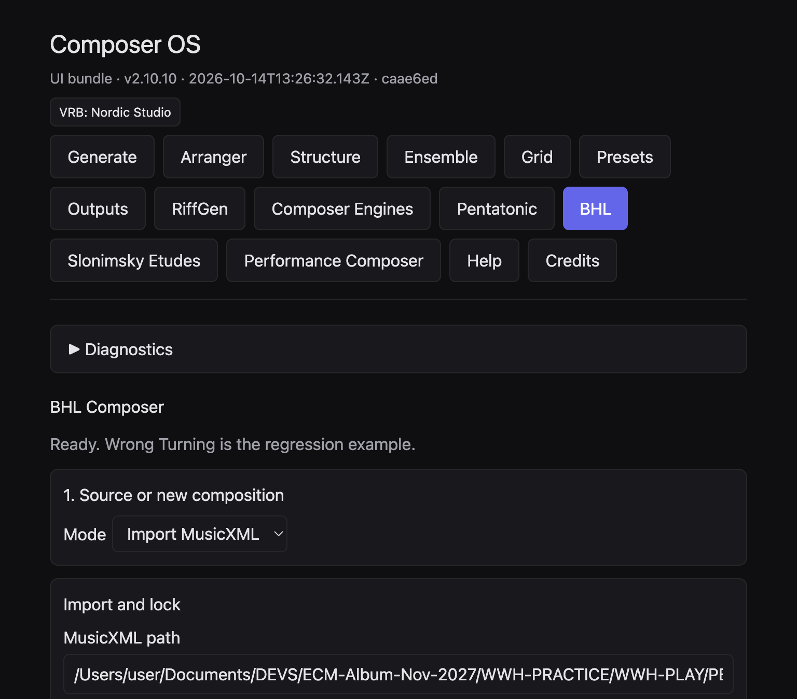
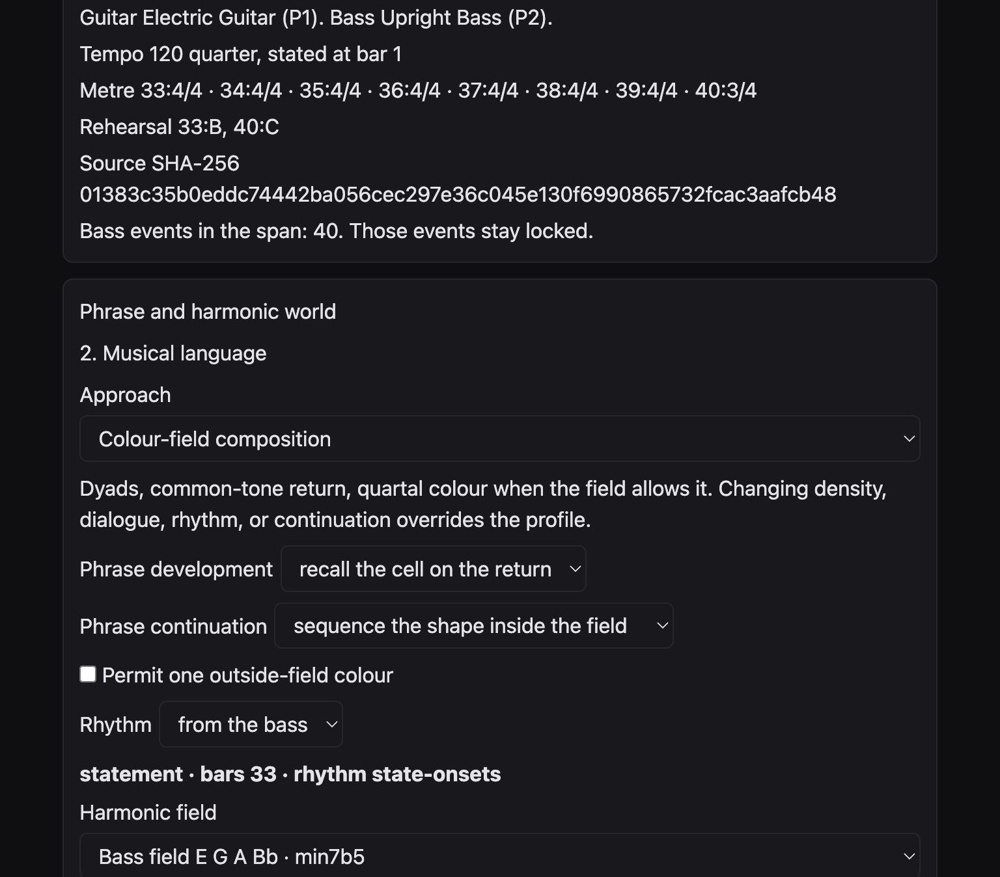

# BHL Composer

**Quick Start Guide**

Version 1.0 · 15 October 2026

Bryant Harmonic Language inside Composer OS.

These pages describe musical choices. They do not ask you to program, and they do not treat any generated score as artistically approved.

## 1. What BHL Composer does {#what}

BHL Composer writes a guitar line against an upright bass. The bass is the locked voice. The guitar answers it with melody, dyads, triads, a counterline, or silence. Harmony moves by common-tone retention, colour, and nonfunctional contrast. It does not offer a ii–V–I or a circle of fifths as a harmonic world.

You choose one of six harmonic worlds, an optional approach, and, when you want it, a pentatonic colour. You can keep a riff’s pitches and change its rhythm, or the other way round. The page then stores three candidates. You compare two of them, refine a copy, and export MusicXML. Nothing on the page is a mark of artistic approval. Every candidate is for audition.

> This guide was checked against the Composer OS web application on 14 October 2026. The installed desktop application dated 13 October 2026 does not yet contain this BHL page. Do not install a new copy as part of this guide.

## 2. Where to find it {#find}

Open the current Composer OS web application. In the row of buttons under the title, click **BHL**. The heading on the page is **BHL Composer**.

The same row also contains **Pentatonic** and **Performance Composer**. Those are separate pages. BHL does not open them for you. What passes between them is described in [Chapter 14](#integrate) and, at more length, in the Creative Scenarios Handbook.

The status line under the heading begins “Ready. Wrong Turning is the regression example.” That sentence names the score used to test the page. It does not mean you must use that score.

## 3. A new composition {#scratch}

Under **1. Source or new composition**, set **Mode** to **New composition**. Four controls appear.

- **Bars** — from 6 to 64. A sixteen-bar miniature is the example in this guide.
- **Beats** — from 2 to 7. This is the top number of the metre.
- **Beat type** — the bottom number. Use 4 for a crotchet beat, 8 for a quaver beat.
- **Tempo** — from 40 to 240. The checked sixteen-bar example uses 92.

Click **Create guitar and bass score**. The page writes a pitched guitar and an upright bass, then asks you to import and lock that new file. The guitar is not an empty rest staff. Its opening pitches sit with the bass so the duo already has a sound before you develop it.

A new file is a starting point, not a finished piece. The bass already has long notes. Your next choices decide how the guitar develops them.

## 4. Import an existing score {#import}

Set **Mode** back to **Import MusicXML** when you already have a file. Under **Import and lock**, paste the full path into **MusicXML path**. On this web page there is no file-chooser button. A desktop build may add **Choose MusicXML**. The checked page does not show that button.

- **From bar** and **To bar** choose the span you will work on. Bars outside that span stay as they are.
- **Seed** is a number. The page says: the same seed and the same controls repeat the same guitar. A different seed moves the world line.
- **Harmonic world** is one of A to F. Set it before you lock if you already know the colour you want. You can still change the world later, then lock again if the page asks you to.

## 5. Lock and protect {#lock}

**Protected guitar bars** takes bar numbers separated by commas, or it stays empty. The placeholder reads “empty, or 33, 36”. A protected guitar bar is left as it stands in the source. The bass is always locked, whether or not you type a number. The page says the bass events in the span stay locked.

Click **Import and lock**. When the lock succeeds, the page names the guitar and the bass, the tempo, the metre of each bar, any rehearsal marks in the span, and the source SHA-256. That long number is the identity of the file you imported. The source file itself is not rewritten.

If you then change the path, the bar span, or the protected bars, the page refuses to generate until you lock again. The message is: “Bar span, path, or protected bars changed. Import and lock again before generating.”

Protection is how you keep a melody or a guitar statement you already trust. Develop the bars around it. Do not expect the protected bar to grow a second voice or a new rhythm.

## 6. The six harmonic worlds {#worlds}

**Harmonic world** is the menu on the import panel. The guitar’s pitch field comes from that choice. None of the six worlds is a chain of fifths.

| World | Name | What the guitar is allowed to use |
| --- | --- | --- |
| A | Triad Pairs | Two major triads a major second apart. They share no pitch class. |
| B | Harmonic Quadratonics | Three chord tones plus one tension tone. This is liquid harmony. |
| C | Major + Augmented | A major triad and the augmented triad on the same root. |
| D | Major + Diminished | A major triad and the diminished triad on the same root. |
| E | Pentatonic Harmony | A pentatonic collection as the pitch source. No leading-tone cadence is implied. |
| F | Unrelated Major Triads | Major triads whose roots sit a minor third apart, and a tritone apart. |

Worlds A, C, D, and F think in triads. You move inside one triad by common tone, then cross to the other triad for contrast. World B keeps three chord tones and treats the remaining tone as the colour that leans away. World E is different: the pentatonic collection is the pitch source, not a filter laid over a triad field.

There is no separate button named Liquid Harmony. If you want that motion, choose **B · Harmonic Quadratonics**.

## 7. The five approaches {#profiles}

After a lock, the page opens **Phrase and harmonic world** and **2. Musical language**. **Approach** is the profile menu. The five names are generation settings. They do not imitate a named player.

| Approach | What it sets |
| --- | --- |
| Chamber lyricism | A sparse single line, a sustained register, and room after the bass. |
| Angular modern jazz | A fragmented development, an inverted contour, and shifting accents. |
| Colour-field composition | Dyads, a common-tone return, and quartal colour when the field allows it. |
| Rhythmic counterpoint | A second guitar voice against the bass, displaced from the statement. |
| Spacious abstraction | A high register, silence, and a short fragmented answer. |

Choosing an approach fills density, dialogue, register, and the development’s pitch behaviour. If you then change density, dialogue, rhythm, or continuation, those later choices replace the approach on that point. The page says so under the menu. **No profile — use the controls below** leaves every region as it was.

Under the approach you will also see each region of the span: statement, transformation, development, continuation, return, or silence, according to the bass phrase. For each region you can set **Harmonic field**, **Motivic development**, **Rhythmic density**, and **Bass dialogue**. Density is dyad, triad, single line, alternate, or counterline. Dialogue is answer after bass, counter-motion, handoff before bass, or leave space.

## 8. Pentatonic colour {#colour}

Open **Pentatonic, motif, and quartal colour**. Tick **Use a pentatonic collection on the development**. Four menus appear.

- **Collection** — twenty colours, from Major Pentatonic to Remote Altered.
- **Reference** — the note the collection is spelled from. D suspended pentatonic spells D E G A C.
- **Relationship** — HOME, MAJOR, 6/9 SUSPENDED, MAJOR 7 COLOUR, or SUSPENDED. This shifts the collection. It does not add a new scale.
- **Contrasting collection** — a second colour for a development or transformation region. **None** leaves the contrast unused.

The page then prints the pitch classes, a short role, and a list of compatible and contrasting pairs. Compatible means three or more shared pitch classes. Contrasting means one or none.

On worlds A to D and F the colour only sounds on pitches the world already contains. If nothing is shared, the guitar stays on the world field. The colour is not rewritten as major or minor pentatonic. On world E the collection is the pitch source, including suspended, Hirajoshi, and the other eighteen colours.

**Quartal colour on dyads when the collection has a fourth** is a separate tick. It does not invent a fourth the collection lacks.

The **Pentatonic** button in the top row opens a different page. There, only Major Pentatonic and Minor Pentatonic can be sent into path transform and phrase generation. The other eighteen collections are reference on that page. They remain real development colours inside BHL. See [the path-page limit](#pathlimit).

## 9. Riff pitch and riff rhythm {#riff}

Open **Riff pitch, riff rhythm, and transformation**. Pitch and rhythm are separate.

- **Riff pitch** — **BHL world pitches** or **Riff contour**. The contour is a cell from the riff generator. Its internal Cmaj7 chord is not copied onto the score.
- **Riff rhythm** — **BHL rhythm**, **This riff’s rhythm**, **Another core cell**, or **Multi-bar engine rhythm**.
- **Rhythm seed** appears only for another core cell and for the multi-bar engine. This riff’s rhythm uses the pitch seed. A different rhythm seed does not change it.
- **Rhythmic transformation** — Original, Continue, Displace, Augment, Diminish, Fragment, or Insert a rest.

**Displace** shows **Displacement in quarter-lengths**. The cell shifts. It is not cut to fit the bar. A note that cannot sit whole inside the bar, or that is finer than the score’s division, is named and left out. It is not quantised. Accents and articulations are not in the riff data, so BHL does not invent them.

Leave-space, a handoff, a silence, and a protected guitar bar still win over the riff grid.

**Original — state the cell once** plays the cell and then leaves later bars silent unless you choose **Continue — repeat the cell**. That silence is a musical result, not a failed export.

## 10. Phrase and motif {#phrase}

**Phrase development** is follow the bass phrase, invert the development, or recall the cell on the return. **Phrase continuation** is keep the region’s dialogue, extend the motif, fragment the motif, sequence the shape inside the field, keep the rhythm and change the pitches, or answer the bass.

Continuation develops a continuation region. It does not develop a region that is silence, a handoff, or leave-space. **Permit one outside-field colour** may admit one tone from outside the field. On world E the return still has to land inside the selected collection. If a return cannot keep a semitone inside the collection, the page reports the limit. It does not force the note.

**Rhythm**, just under continuation, is from the bass, displace, syncopate, or sparse. When riff rhythm is set to BHL rhythm, this menu still writes the guitar attacks. When riff rhythm is a riff cell, the riff attacks replace this menu.

**Replace the opening cell**, inside the pentatonic panel, is a separate choice. The motif can come from imported pitches, from intervals, or from the riff generator, and can then be transposed, inverted, fragmented, or moved in register. Leave it off when the world’s own cell is the idea you want to hear.

Motivic development on a region uses one of: neighbor-statement, invert-into-field, reproject-neighbor, recall-cell, retain-and-admit-bass. Those names are the menu. They mean: state a neighbour tone, turn the contour into the field, set the neighbour in a new place, bring the cell back, or keep the cell and let a bass tone in.

## 11. Three candidates {#candidates}

**Generate guitar** writes one line from the controls you see. **5. Candidates** is the place for a comparison. Click **Generate three candidates**. The page stores three guitar lines. In one checked session the rows were Candidate 1 seed 3340, Candidate 2 seed 3357, and Candidate 3 seed 3369. Another session can show other seeds. The three rows are the point, not those particular numbers.

There is no score and no automatic winner. The panel says: **CANDIDATE FOR AUDITION — NOT MUSICALLY APPROVED**.

The headings on the page jump from **2. Musical language** to **5. Candidates** and then to **7. Save**. There is no heading numbered 3, 4, or 6. That is the layout of this edition, not a missing step.

## 12. Compare and refine {#refine}

Select one candidate. **Compare stored candidates** compares that row with one other stored line. It is a pair, not a three-way table. The readout counts guitar attacks, rests, voices, and silences, and it says the analysis is provisional until you review the original-score evidence. It does not tell you which line is better.

**Refine a copy** is enabled once a candidate is selected. The new row names its parent, for example “Candidate 1 refined · seed 3341 · refined from Candidate 1”. The original row stays in the list. Refinement does not replace the line you started from.

If you change controls after a line has been written, the candidate panel can mark that line stale. Generate again when you want the new controls in the notes.

## 13. Save and reopen {#save}

**7. Save** needs at least one candidate. **Save project** stays disabled until then.

- **Project id** — a short name, such as ballad-suspended-d.
- **Notes** — your own reminder: world, colour, what you meant to keep.
- **Save project** — writes a BHL project file. The musical settings travel with it, including the world, the riff choice, and the contrasting collection.
- **Project path** — the file to open.
- **Reopen project** — puts those settings back on the controls and restores the locked source and the harmonic world.

Save the project before you change world or colour if you want the earlier version. The refined row and its parent can sit in the same file. That is how you keep an earlier candidate while you try another.

## 14. Export MusicXML {#export}

After **Generate guitar**, the **Candidate** panel can show **Export MusicXML**. Export stays disabled until the locks pass. The page reports whether the locks passed, whether a reimport passed, and whether the bars outside the span still match the source.

The exported file is written to the BHL export folder. The source file stays where it is. The page prints the export path. Do not copy an export back over a score you meant to protect.

The button beside the path is labelled **Open in Sibelius**. For this project, do not use that button. BHL itself does not play audio. Take the MusicXML path and open it in MuseScore 4, as the next chapter describes. The colour panel may still say “audition in Sibelius”. That sentence is out of date for this workflow.

## 15. Open the score in MuseScore 4 {#musescore}

In MuseScore 4, use **File** and **Open**, and choose the exported MusicXML. Do not open it by replacing a score you already have open and care about. Save any MuseScore file under a new name. An MSCZ is MuseScore’s own file. It is not a substitute for the MusicXML, and saving it must not overwrite the MusicXML.

To make a PDF, use **File** and **Export**. Keep the MusicXML as the musical source. The PDF is a picture of one engraving.

Read the first system at the size you would use at a stand. Check that the guitar and the bass are both present, that the metre matches what you asked for, and that a rehearsal letter has not collided with the notes. One verified sixteen-bar page does have that collision. It is described in the walkthrough. It is an engraving fault in that file, not a reason to treat the piece as approved, and not a reason to “fix” it by editing the source in another program as part of this guide.

## 16. Common problems and limits {#limits}

- The installed desktop app of 13 October 2026 will not show these controls. Use the current web application.
- BHL does not play audio. There is no audition button that you should trust for this project.
- Artist-named profiles are not available.
- Compare reads two stored candidates, not all three at once. Select another row and compare again.
- A note that does not fit the bar or the division grid is omitted, not quantised.
- Diminish can fail when every attack would be finer than the score allows. The page reports that the rhythm did not fit.
- Insert a rest needs a note of at least half a crotchet to split. Otherwise the transform is reported unavailable.
- A contrast collection does nothing if the span has no development or transformation region.
- An empty shared set between a colour and worlds A–D or F leaves the guitar on the world. It does not snap to major or minor.
- Path transform on the Pentatonic page accepts only major and minor pentatonic.
- Performance Composer does not take a BHL project. It takes an exported MusicXML file, opened with Respond.
- The Riff page does not import a BHL file. Rhythm and contour travel into BHL, not back out.
- Section numbers on the BHL page skip 3, 4, and 6.
- No candidate is musically approved by being generated, exported, or opened.

## 17. A sixteen-bar walkthrough {#walk}

This walk uses a real verified file: a sixteen-bar electric guitar and upright bass at crotchet 92, in 4/4, titled “BHL from scratch repaired”. Rehearsal letters A, B, C, D, and E mark the phrase. The bass moves in long notes, halves at first and then longer values. The guitar is sparse: rests, a dyad, single notes, and silence toward the end. The words “CANDIDATE FOR AUDITION — NOT MUSICALLY APPROVED” are printed across the first system and collide with the notes. Treat the page as a technical example of the duo, not as a finished composition.

Musical aim: a short chamber duo in which the bass proposes long tones and the guitar answers lightly, with room, and without a functional cadence.

### Do this {#walk-do}

1. Click **BHL**.
2. Set **Mode** to **New composition**. Bars 16, beats 4, beat type 4, tempo 92. Click **Create guitar and bass score**.
3. The status line names the new file and tells you to import and lock it. The path should already be in **MusicXML path**. Set **From bar** 1 and **To bar** 16. Set **Seed** to 3340 if you want a repeatable starting point. Leave **Protected guitar bars** empty for the first pass.
4. Set **Harmonic world** to **E · Pentatonic Harmony**. Click **Import and lock**. Read the metre and the SHA-256. Confirm the bass events are locked.
5. Set **Approach** to **Chamber lyricism**. Read the sentence under the menu. Leave the region controls alone for this first pass, so the approach can set a single line and room after the bass.
6. Open **Pentatonic, motif, and quartal colour**. Tick **Use a pentatonic collection on the development**. Collection **Suspended Pentatonic**, reference **D**, relationship **HOME**, contrasting collection **Hirajoshi**. Read the pitch classes. Suspended on D is D E G A C: no third.
7. Open **Riff pitch, riff rhythm, and transformation**. For this first pass set **Riff pitch** to **BHL world pitches** and **Riff rhythm** to **BHL rhythm**. Set **Rhythmic transformation** to **Continue — repeat the cell** only if you want the cell to return. **Original** states it once.
8. Click **Generate three candidates**. Select the first. Click **Compare stored candidates**. Read attacks, rests, and silences. Do not look for a winning score.
9. Click **Refine a copy**. Confirm the parent row is still there.
10. Under **7. Save**, set a project id such as sixteen-bar-suspended. Write a note of the world and the colour. Click **Save project**. Keep the path.
11. Click **Generate guitar** on the candidate you want to keep, then **Export MusicXML** once the locks pass. Leave the source file where it is.
12. In MuseScore 4, choose File, then Open, and choose the export. Read the sixteen bars. Expect guitar and bass, 4/4, and a slow-feeling 92. Expect silence as part of the line.

If you only wanted to study the verified page, open the existing MusicXML “from-scratch-seed3340-16bars-generated” from the BHL examples folder in MuseScore 4. Do not overwrite it. Figure 11 is that page.

### What to listen for on the page, with the eye {#walk-eye}

You are not asked to play the file for this guide. Read it. The bass is the sentence. The guitar either shares a tone, answers after a rest, or stays out. A dyad is one grip, not a rhythm-section chord on every beat. The later bars, under E, are almost empty in the guitar. That emptiness is the release. If your own export is busier, you chose a denser approach or a continuing riff. Chamber lyricism and leave-space are the controls that restore the room.

## 18. One-page workflow {#workflow}

| Step | Control | Musical decision |
| --- | --- | --- |
| 1 | BHL | Open the composer. |
| 2 | New composition or Import MusicXML | Start empty, or bring a score. |
| 3 | Bars, beats, beat type, tempo | Length, metre, and pace. |
| 4 | From bar, To bar, Seed | Which phrase, and which repeatable guitar. |
| 5 | Harmonic world A–F | The pitch field. Not a circle of fifths. |
| 6 | Protected guitar bars | The guitar music you refuse to rewrite. |
| 7 | Import and lock | Bass locks. Source file stays put. |
| 8 | Approach | Lyric, angular, colour, counterpoint, or space. |
| 9 | Collection, reference, relationship, contrast | Pentatonic colour, if you want it. |
| 10 | Riff pitch and riff rhythm | Contour and attacks, chosen apart. |
| 11 | Rhythmic transformation | Once, continue, shift, stretch, halve, cut, or rest. |
| 12 | Generate three candidates | Three seeds. No winner. |
| 13 | Compare, then Refine a copy | A pair of counts, then a child that keeps its parent. |
| 14 | Save project | So the next session restores the world and the colour. |
| 15 | Export MusicXML | A new file. The source stays. |
| 16 | MuseScore 4, File, Open | Read the duo. Do not use Open in Sibelius. |

World E takes the collection as its pitch source. Worlds A to D and F keep their own fields and only borrow a colour where the pitches already agree. Liquid harmony is world B. The vault choice is the **Harmonic field** menu on a region, not a second application launched from this page.

## 19. Glossary {#glossary}

| Term | Meaning on this page |
| --- | --- |
| Approach | One of five measurable settings. Not an impression of a named artist. |
| Candidate | One stored guitar result. Marked for audition, not approved. |
| Collection | One of the twenty pentatonic colours. |
| Common tone | A pitch class two chords, or a line and a bass, can share. |
| Contrast | A move to the other triad, the tension tone, or a second collection. |
| Dialogue | How the guitar sits against the bass: after, against, before, or with a gap. |
| Dyad | Two notes played as one grip. |
| Harmonic world | The pitch field, A to F. |
| Lock | A recorded reading of the source. The bass in the span will not be rewritten. |
| Reference | The note a collection is spelled from. |
| Relationship | A shift of a collection. Not an extra scale. |
| Seed | The number that repeats a guitar when the other controls stay the same. |
| Triad | Three notes as one grip, not a continuous accompaniment. |
| World E | Pentatonic harmony. The selected collection is the pitch source. |

Further scenarios, including mixed metre, each colour, and the limits of Performance Composer, are in the Creative Scenarios & Integration Handbook, version 1.0, dated 15 October 2026.

### Path-page limit {#pathlimit}

On the Pentatonic page, **Use for path transform and phrase generation** appears only on Major Pentatonic and Minor Pentatonic. Suspended Pentatonic and the other seventeen colours show this sentence: path transform, phrase generation, M-DEG, and M-NEAR support major and minor only. The collection is reference material. Its pitches are not sent to those operations. Inside BHL, the same collection can still colour a development.

### Where integration stops {#integrate}

Open **Cross-engine transfer** on the BHL page after a lock. The paragraph there is the contract. Riff pitch, this riff’s rhythm, another core cell, and the multi-bar rhythm move straight into BHL. Pentatonic colours move straight in. Tonality Vault is the harmonic-field menu on each region. Liquid harmony is world B. Performance Composer accepts a MusicXML file only: export, then on that page use **Respond** and choose the file. The Riff Engine does not import BHL.

