# BHL Composer

**Creative Scenarios and Integration Handbook**

Version 1.0 · 15 October 2026

Bryant Harmonic Language inside Composer OS.

These pages describe musical choices. They do not ask you to program, and they do not treat any generated score as artistically approved.

## How to use this handbook {#how}

Each scenario is a musical job you can do on the BHL page of the current Composer OS web application. The controls are the ones on that page. The installed desktop application dated 13 October 2026 does not yet contain them. This handbook does not ask you to install software, to program, or to approve a generated line by ear.

Read the aim before you touch a menu. The settings name the real controls. The result describes what the process is built to produce. It is not a promise of a beautiful piece. Every candidate remains marked **CANDIDATE FOR AUDITION — NOT MUSICALLY APPROVED**.

Worlds, colours, and transfers are summarised in [Chapter B](#worlds), [Chapter C](#colours), and [Chapter G](#integrate). The Quick Start Guide, version 1.0, is the shorter path if you have not locked a score before.

Cross-engine facts that must not be blurred:

- All twenty colour collections are available as BHL development colours. On worlds A to D and F they only sound where the world already contains those pitches.
- World E uses the selected collection as its pitch source.
- The separate Pentatonic page can run path transform and phrase generation for all twenty colours. An unknown colour is refused. It does not substitute minor pentatonic.
- Performance Composer accepts an exported MusicXML file through **Respond**. It does not accept a BHL project object.
- The Riff Engine does not import a BHL project. Contour and rhythm travel into BHL only.

## A. Starting a composition {#start}

A BHL piece begins as a guitar and upright bass, either from an empty count of bars or from a span of a score you already trust. The bass will be locked. The guitar is the voice you develop. Think of the guitar as a chamber partner: line, dyad, triad, counterline, or silence. Not a chord on every beat.

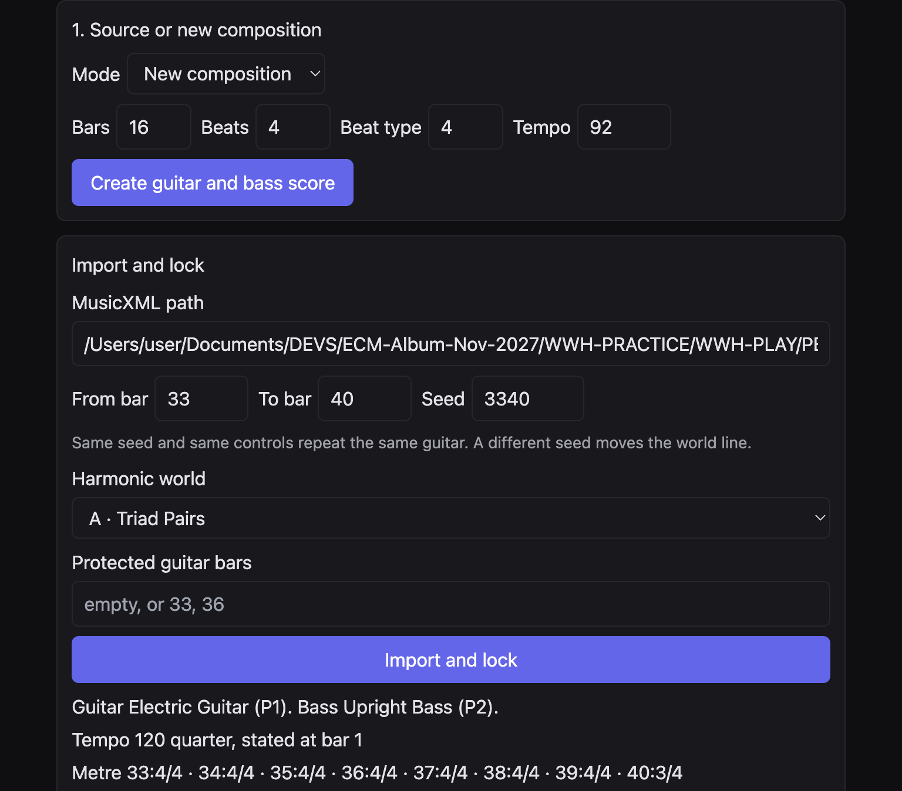

### Scenario 1. Sixteen-bar chamber canvas {#s01}

#### Musical aim {#s01a}

A short duo with room for a statement, a turn, and a quiet close.

#### Starting material {#s01b}

No existing score. You only need a length, a metre, and a tempo.

#### BHL settings {#s01c}

- Mode: New composition.
- Bars 16, beats 4, beat type 4, tempo 92.
- After the file exists: From bar 1, To bar 16, seed of your choice.
- Harmonic world E · Pentatonic Harmony.
- Protected guitar bars empty.
- Approach: Chamber lyricism.

#### Procedure {#s01d}

1. Click BHL.
2. Create the guitar and bass score.
3. Import and lock the new path for bars 1 to 16.
4. Leave the region controls on the approach.
5. Generate three candidates.

#### Expected musical result {#s01e}

A sixteen-bar 4/4 duo at 92. The bass holds long tones. Chamber lyricism asks the guitar for a sparse single line and space after the bass. The three candidates share that posture and differ by seed.

#### Variations {#s01f}

- Tempo 72 makes the same bars feel like a ballad. See Scenario 65.
- World A instead of E makes the guitar think in two major triads a tone apart.

#### Limitations {#s01g}

Six bars is the shortest new score. Sixty-four is the longest. The new file must still be locked before Generate three candidates will run.

### Scenario 2. The shortest study, six bars {#s02}

#### Musical aim {#s02a}

A motif and one answer, with no time for a large form.

#### Starting material {#s02b}

None. A six-bar new score.

#### BHL settings {#s02c}

- Mode: New composition.
- Bars 6, beats 4, beat type 4, tempo 84.
- World A · Triad Pairs.
- Approach: No profile — use the controls below.
- Rhythmic transformation: Original — state the cell once.

#### Procedure {#s02d}

1. Create the score.
2. Lock bars 1 to 6.
3. Set the first region’s density to single line and its dialogue to answer after bass.
4. Generate guitar.

#### Expected musical result {#s02e}

Six bars. The cell is stated once. Later bars stay silent unless you change the transformation to Continue. The silence after the statement is the form.

#### Variations {#s02f}

- Fragment the motif instead of Original, so only the opening of the cell speaks.
- Protect bar 1 after you like the statement, then generate again so the answer cannot erase it.

#### Limitations {#s02g}

Thematic return and large form are not meaningful in six bars. Do not judge this study as a full piece.

### Scenario 3. A seven-eight canvas {#s03}

#### Musical aim {#s03a}

An asymmetric groove whose bar is seven quavers, not a 4/4 sentence squeezed.

#### Starting material {#s03b}

None.

#### BHL settings {#s03c}

- Mode: New composition.
- Bars 16, beats 7, beat type 8, tempo 126.
- World D · Major + Diminished.
- Approach: Angular modern jazz.
- Riff rhythm: BHL rhythm.
- Rhythm menu: syncopate.

#### Procedure {#s03d}

1. Create the score.
2. Lock the whole span.
3. Read the metre line. It should show 7/8 on the bars you created.
4. Generate three candidates.

#### Expected musical result {#s03e}

Sixteen bars of 7/8. Angular modern jazz fragments the development and inverts the contour. The guitar’s accents sit off the bass rather than decorating a square bar.

#### Variations {#s03f}

- Beat type 8 with beats 5 gives 5/8, a shorter asymmetric bar.
- Switch the approach to Rhythmic counterpoint if you want a second guitar voice rather than a broken single line.

#### Limitations {#s03g}

The new-score beats control accepts 2 to 7 only. A bar of 9, or a changing metre inside one new score, is not this control. Mixed metre inside one piece is Scenario 51, and it starts from a score that already changes metre.

### Scenario 4. A slow five-four ballad frame {#s04}

#### Musical aim {#s04a}

A wide bar in which the bass can breathe and the guitar can enter late.

#### Starting material {#s04b}

None.

#### BHL settings {#s04c}

- Bars 16, beats 5, beat type 4, tempo 60.
- World E · Pentatonic Harmony.
- Approach: Spacious abstraction.
- Dialogue, if you override the approach: leave space.
- Collection off for the first lock, so you hear the world’s own pentatonic first.

#### Procedure {#s04d}

1. Create and lock.
2. Generate one guitar.
3. Then tick a collection and generate three candidates so you can compare the plain world with a coloured copy. Save before the second generate if you want both.

#### Expected musical result {#s04e}

A slow 5/4. Spacious abstraction prefers a high register, silence, and a short fragmented answer. The five beats give the bass time before the guitar speaks.

#### Variations {#s04f}

- Colour-field composition in the same 5/4 replaces the high silence with dyads.
- Reference D and Suspended Pentatonic, later, take the third out of the colour. See Scenario 21.

#### Limitations {#s04g}

Changing bars, path, or protected bars after the lock requires a new lock. Changing the approach does not.

### Scenario 5. Bring in a span you already trust {#s05}

#### Musical aim {#s05a}

Develop eight bars inside a longer score without touching the rest of the file.

#### Starting material {#s05b}

A MusicXML score that already contains guitar and bass. The regression example used on the page is Wrong Turning, bars 33 to 40. You may use another file. Do not overwrite the original.

#### BHL settings {#s05c}

- Mode: Import MusicXML.
- MusicXML path: the full path of a copy, if the original must stay byte-for-byte untouched.
- From bar and To bar: the eight bars you mean to touch.
- Seed 3340 for a repeatable first reading.
- World A · Triad Pairs.
- Protected guitar bars empty, until you know which bar must survive.

#### Procedure {#s05d}

1. Paste the path.
2. Set the span.
3. Import and lock.
4. Read tempo, metre, rehearsal marks, and the SHA-256.
5. Generate guitar only inside that span.

#### Expected musical result {#s05e}

The locked span can receive a new guitar. Bars outside the span are checked against the source. The bass events inside the span stay. The source file is not the export.

#### Variations {#s05f}

- Protect the first bar of the span so its guitar remains the source. See Scenario 6.
- Move the same span to world E and save a second project, so both worlds remain.

#### Limitations {#s05g}

A wrong path, or a span that does not contain both instruments, will not lock. The web page does not offer a file chooser. A desktop build may show Choose MusicXML. This checked page does not.

### Scenario 6. Protect the guitar statement {#s06}

#### Musical aim {#s06a}

Keep one guitar bar exactly, and let the following bars answer it.

#### Starting material {#s06b}

A locked span in which bar 1, or another bar you name, already holds the guitar idea.

#### BHL settings {#s06c}

- Protected guitar bars: the bar number, for example 1, or 33.
- Riff rhythm may be anything.
- Dialogue on later regions: answer after bass.
- Do not expect counter-motion on the protected bar.

#### Procedure {#s06d}

1. Type the bar numbers.
2. Import and lock again. Protection is part of the lock.
3. Generate.
4. Export, and in MuseScore 4 compare the protected bar with the source.

#### Expected musical result {#s06e}

The named guitar bar stays the source, including pitches, durations, and where the notes start. Later bars may answer. A second guitar voice does not rewrite the protected bar.

#### Variations {#s06f}

- Protect two bars, written as 33, 36, when both a statement and a later rhyme must survive.
- Leave the field empty when the whole span is allowed to change.

#### Limitations {#s06g}

If you edit the protected text after locking, Generate waits until you lock again. The bass is locked even when this box is empty.

## B. The six harmonic worlds {#worlds}

The world is the guitar’s pitch field. It is chosen under **Harmonic world** before or at the lock. Common-tone retention keeps you inside one sound. Contrast is the step to the other triad, the tension tone, or the other collection. None of these worlds is a ii–V–I.

| World | Common tone | Contrast |
| --- | --- | --- |
| A Triad Pairs | A chord tone inside one major triad | The other major triad, a major second away. No shared pitch class. |
| B Harmonic Quadratonics | The three chord tones | The primary tension, from liquid harmony. |
| C Major + Augmented | The major third | The raised fifth, and an augmented triad a major third away. |
| D Major + Diminished | The root | The minor third and the tritone. |
| E Pentatonic Harmony | Tones inside the collection | A contrasting collection, or one reported outside tone. |
| F Unrelated Major Triads | The one shared tone of a minor-third pair | The tritone triad, which shares none. |

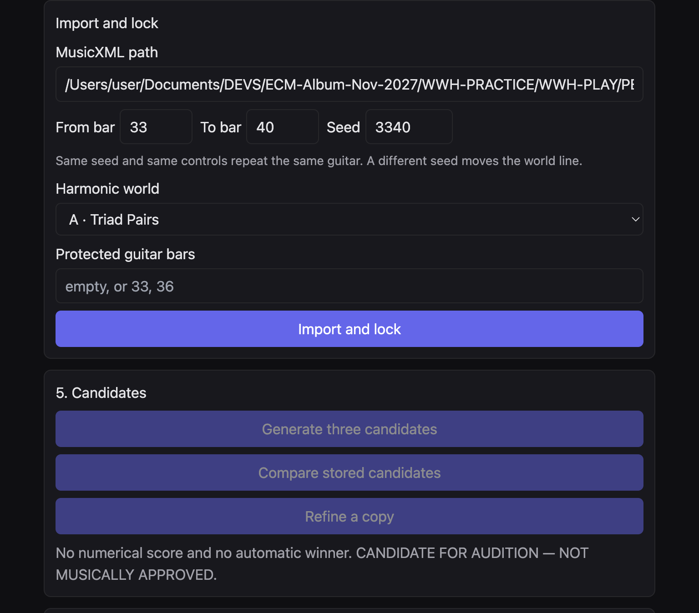

### Scenario 7. Stay inside one triad of a pair {#s07}

#### Musical aim {#s07a}

A line that sounds like one major triad, with no drift yet.

#### Starting material {#s07b}

A locked span. World A. Bass root clear in the first bars.

#### BHL settings {#s07c}

- Harmonic world A · Triad Pairs.
- Approach: Colour-field composition.
- Density on the statement: dyad.
- Phrase development: follow the bass phrase.
- Pentatonic collection off, so the triad is heard alone.

#### Procedure {#s07d}

1. Lock world A.
2. Set the statement to dyad.
3. Generate guitar.
4. Read the dyads against the bass root. They should belong to one of the two triads.

#### Expected musical result {#s07e}

Two major triads a major second apart, sharing no pitch class. This pass asks the guitar to live inside one of them. Dyads keep the grip small. The other triad is still available, but you have not asked for the cross.

#### Variations {#s07f}

- Scenario 8 makes the cross the point.
- A single line instead of a dyad turns the same triad into melody.

#### Limitations {#s07g}

The two triads share nothing. A note from the second triad is contrast, not a colour tone of the first. Do not rename that contrast as a seventh or a dominant.

### Scenario 8. Cross to the triad a tone away {#s08}

#### Musical aim {#s08a}

A nonfunctional lift: the same bar-length, a new major triad with no common pitch.

#### Starting material {#s08b}

World A already locked. You have heard one triad.

#### BHL settings {#s08c}

- World A.
- Phrase development: invert the development.
- On the development region, motivic development: invert-into-field.
- Continuation: sequence the shape inside the field.
- Collection still off.

#### Procedure {#s08d}

1. Keep the lock.
2. Set the development to invert into the field.
3. Generate three candidates.
4. Compare attacks. Then read which candidate actually crosses.

#### Expected musical result {#s08e}

The contrast triad sits a major second away and shares no pitch class. Inversion pushes the contour toward that other group. The bass does not have to cadence. The shock is the empty intersection, not a dominant.

#### Variations {#s08f}

- Displace the rhythm so the new triad arrives off the bass attack.
- Protect the statement bar so the first triad remains recognisable when the second arrives.

#### Limitations {#s08g}

If a pentatonic colour is also on, it can sound only on pitches the triads already contain. An empty intersection leaves the guitar on the world. It does not invent a compromise scale.

### Scenario 9. Three chord tones, nothing else {#s09}

#### Musical aim {#s09a}

A quadratonic heard as a chord, before its tension tone is admitted.

#### Starting material {#s09b}

World B. A locked bass.

#### BHL settings {#s09c}

- Harmonic world B · Harmonic Quadratonics.
- Approach: Chamber lyricism.
- Permit one outside-field colour: off.
- Harmonic field on the region: leave the bass field, or choose another vault field if the menu offers one.
- Collection off.

#### Procedure {#s09d}

1. Lock world B.
2. Generate guitar.
3. Open Cross-engine transfer and read that liquid harmony is direct on world B.

#### Expected musical result {#s09e}

World B asks liquid harmony for one quadratonic: three chord tones plus a primary tension. This calm setting lets the chord tones carry the line. The tension tone is present in the field as the contrast group, but the lyric approach does not feature it.

#### Variations {#s09f}

- Scenario 10 features the tension.
- Colour-field dyads make the same quadratonic vertical rather than melodic.

#### Limitations {#s09g}

There is no Liquid Harmony button. World B is the integration. The full Tonality Vault screen, with fretboard and tab, is a different page. BHL does not embed it. There is no guitar tablature in this handbook.

### Scenario 10. Let the tension tone lean {#s10}

#### Musical aim {#s10a}

The same quadratonic, now with the non-chord tone as the colour that pulls.

#### Starting material {#s10b}

World B, locked.

#### BHL settings {#s10c}

- World B.
- Approach: Angular modern jazz.
- Permit one outside-field colour: on.
- Motivic development on the development: reproject-neighbor.
- Continuation: fragment the motif.

#### Procedure {#s10d}

1. Set the approach.
2. Tick the outside colour.
3. Generate three candidates.
4. Use the pair comparison to see which line is more broken.

#### Expected musical result {#s10e}

The tension tone is the contrast inside the quadratonic. One outside tone may appear because you allowed it. The return is still supposed to land in the field. Fragmentation keeps the answer short, so the tension does not become a scale run.

#### Variations {#s10f}

- Turn the outside tick off and refine a copy. The parent keeps the lean; the child can be plainer.
- Recall the cell on the return so the chord tones close the phrase.

#### Limitations {#s10g}

Outside colour is one tone, not a licence to leave the field. On world E the return must still sit in the collection. If it cannot keep a semitone, the page reports the limit.

### Scenario 11. Major triad, then its raised fifth {#s11}

#### Musical aim {#s11a}

A major sound that brightens by a raised fifth, sharing the major third.

#### Starting material {#s11b}

World C. Locked bass.

#### BHL settings {#s11c}

- Harmonic world C · Major + Augmented.
- Approach: Colour-field composition.
- Density: dyad.
- Phrase development: recall the cell on the return.
- Quartal colour: off, so the augmented fifth is not confused with a fourth.

#### Procedure {#s11d}

1. Lock world C.
2. Generate guitar.
3. Read dyads for a major third that stays and a fifth that sometimes rises.

#### Expected musical result {#s11e}

The major triad and the augmented triad share a root and a major third. The raised fifth is the contrast. Recall brings the opening cell back after that brightening, so the phrase has a memory.

#### Variations {#s11f}

- Single line instead of dyad makes the raised fifth a melodic event.
- Scenario 12 moves the augmented triad by a major third as well.

#### Limitations {#s11g}

This is not a dominant augmented sixth and not a resolution to a tonic. Do not add a cadence the world does not write.

### Scenario 12. Spin the augmented triad by a major third {#s12}

#### Musical aim {#s12a}

Augmented symmetry as motion: the same colour, a new root a major third away, still not a fifth.

#### Starting material {#s12b}

World C, after Scenario 11 or instead of it.

#### BHL settings {#s12c}

- World C.
- Approach: Angular modern jazz.
- Phrase development: invert the development.
- Continuation: sequence the shape inside the field.
- Rhythm: displace.

#### Procedure {#s12d}

1. Lock or keep the lock.
2. Set invert and sequence.
3. Generate three candidates.

#### Expected musical result {#s12e}

The field includes the augmented triad on the bass root and the augmented triad a major third away. Inversion and sequence move the shape between those groups. Displacement keeps the guitar off the bass attack. The root step is a major third, which the world treats as legal. A fifth is not the operation.

#### Variations {#s12f}

- Continue the riff cell so the spin becomes an ostinato.
- Protect the first bar so the unspun major triad remains the reference.

#### Limitations {#s12g}

A pentatonic colour on this world only survives where it already belongs to the major-plus-augmented field. Shared pitches are named after Generate, under Harmonic-field interaction.

### Scenario 13. A major triad darkened from the root {#s13}

#### Musical aim {#s13a}

The root stays. The minor third and the tritone cloud it.

#### Starting material {#s13b}

World D.

#### BHL settings {#s13c}

- Harmonic world D · Major + Diminished.
- Approach: Chamber lyricism.
- Density: single line.
- Dialogue: leave space.
- Outside colour: off.

#### Procedure {#s13d}

1. Lock world D.
2. Generate guitar.
3. Look for a shared root with the bass and for a minor third or tritone as the colour, with rests after the bass moves.

#### Expected musical result {#s13e}

Major triad plus diminished triad on the same root. The root is the common tone. The minor third and the tritone are the contrast. Lyricism and leave-space keep that colour from becoming a busy diminished scale.

#### Variations {#s13f}

- Dyads stack the root with the tritone as one grip.
- Scenario 14 makes the contrast the whole argument.

#### Limitations {#s13g}

Do not relabel the tritone as a dominant that must resolve. The world does not take a fifth-step.

### Scenario 14. Feature the minor third and the tritone {#s14}

#### Musical aim {#s14a}

A sharper reading of world D, still rooted, no longer shy.

#### Starting material {#s14b}

World D, locked.

#### BHL settings {#s14c}

- World D.
- Approach: Rhythmic counterpoint.
- Density: counterline.
- Dialogue: counter-motion.
- Rhythm: displace.
- Continuation: answer the bass.

#### Procedure {#s14d}

1. Apply the approach.
2. Generate three candidates.
3. Compare voices. Counter-motion is the setting that can write a second guitar voice.

#### Expected musical result {#s14e}

A second guitar voice moves against the bass, displaced from the statement. The pitch field is still the major triad plus the diminished triad. The minor third and tritone can occupy the second voice while the first keeps the root.

#### Variations {#s14f}

- Handoff before bass gives the guitar the bar and clears before the next bass note.
- Fragment the motif so the tritone is a gesture, not a line.

#### Limitations {#s14g}

Counter-motion does not override a protected bar or a silence. If the comparison shows only voice 1, the region was not a counter-motion region, or the bar was protected.

### Scenario 15. Pentatonic harmony as the whole field {#s15}

#### Musical aim {#s15a}

A guitar that lives inside a pentatonic collection, with no leading-tone cadence.

#### Starting material {#s15b}

A new or imported span. World E.

#### BHL settings {#s15c}

- Harmonic world E · Pentatonic Harmony.
- Collection off for this first hearing, so the world’s own description applies: major pentatonic on the bass root, as pentatonic dyads, no leading tone and no dominant seventh.
- Approach: Colour-field composition.
- Density: dyad.

#### Procedure {#s15d}

1. Lock world E.
2. Leave the collection unticked.
3. Generate guitar.
4. Then tick Major Pentatonic at the bass’s reference if you want the same colour named explicitly. Generate a refined copy.

#### Expected musical result {#s15e}

World E’s default field is major pentatonic thinking on the bass root. Dyads stack fifths and sixths from that set. There is no leading tone pushing to a tonic, and no dominant seventh.

#### Variations {#s15f}

- Scenario 16 replaces that default with another of the twenty collections.
- Suspended Pentatonic removes the third. See Scenario 21.

#### Limitations {#s15g}

Once a collection is selected, world E takes that collection as the pitch source, including collections that are only reference on the Pentatonic page. Return notes stay inside it.

### Scenario 16. Replace world E’s source with a named collection {#s16}

#### Musical aim {#s16a}

The same pentatonic world, now spelled from a colour you choose, not from the default major pentatonic.

#### Starting material {#s16b}

World E, locked.

#### BHL settings {#s16c}

- World E.
- Use a pentatonic collection on the development: on.
- Collection: Hirajoshi.
- Reference: D.
- Relationship: HOME.
- Contrasting collection: None.

#### Procedure {#s16d}

1. Tick the collection.
2. Set Hirajoshi and D.
3. Read the pitch classes on the page before you generate.
4. Generate.
5. Open Harmonic-field interaction and read the constraint.

#### Expected musical result {#s16e}

Hirajoshi at D is the pitch source, not a filter. Intervals from the reference are 0, 2, 3, 7, 8. The line may be dark and narrow. It should not be rewritten as major pentatonic. A repaired demonstration of this world kept a return inside the collection and did not put B natural where the collection forbade it.

#### Variations {#s16f}

- Contrast Suspended Pentatonic against Hirajoshi. See Scenario 23.
- Relationship SUSPENDED shifts this same Hirajoshi. It does not create a twenty-first scale.

#### Limitations {#s16g}

If a return cannot keep a semitone inside the collection, the limitation is reported. The note is not forced. That is a success of the limit, not a broken file.

### Scenario 17. Two major triads a minor third apart {#s17}

#### Musical aim {#s17a}

A pair that can keep one shared tone, with roots that are not a fourth or a fifth.

#### Starting material {#s17b}

World F.

#### BHL settings {#s17c}

- Harmonic world F · Unrelated Major Triads.
- Approach: Colour-field composition.
- Phrase development: recall the cell on the return.
- Density: dyad.
- Collection off.

#### Procedure {#s17d}

1. Lock world F.
2. Generate guitar.
3. Listen with the eye for one pitch that survives the change of triad, and for roots a minor third apart.

#### Expected musical result {#s17e}

World F places major triads at the minor third and at the tritone. The minor-third pair can keep its one shared tone. Recall puts the opening cell back, so that shared tone can be the memory.

#### Variations {#s17f}

- Scenario 18 removes even that one shared tone, by favouring the tritone triad.
- A single line makes the shared tone melodic rather than a dyad.

#### Limitations {#s17g}

Those roots are not a fourth and not a fifth. Do not ‘correct’ the bass motion into a cycle.

### Scenario 18. The tritone triad, no shared pitch {#s18}

#### Musical aim {#s18a}

A major triad with nothing in common with the one you just left.

#### Starting material {#s18b}

World F, locked.

#### BHL settings {#s18c}

- World F.
- Approach: Spacious abstraction.
- Dialogue: leave space.
- Continuation: fragment the motif.
- Phrase development: invert the development.

#### Procedure {#s18d}

1. Set the approach.
2. Generate three candidates.
3. Choose the line whose answer is shortest. Refine a copy of that one if you want a still shorter reply.

#### Expected musical result {#s18e}

The tritone triad shares no pitch class with the triad a tritone away. Space and fragmentation keep the shock to a few notes and a rest. Inversion aims the contour at the remote triad rather than decorating the first one.

#### Variations {#s18f}

- Counter-motion lets a second voice hold a tone from the first triad while the first voice takes the remote triad. Only if the region is not protected.
- Save this project under a different id from Scenario 17 so the shared-tone version survives.

#### Limitations {#s18g}

An added pentatonic colour cannot glue the two triads together. If it shares nothing with the field, the guitar stays on the world.

## C. Pentatonic colour {#colours}

Tick **Use a pentatonic collection on the development**. Twenty collections appear. The relationship menu shifts the one you chose. **Contrasting collection** names a second colour. The page prints pitch classes and pairs before you generate.

Roles below are the musical jobs of the collections, spelled at C as the registry shows them. Choose another reference when the bass lives somewhere else. D suspended, for example, is D E G A C.

| Collection | Intervals from the reference | Spelling at C | Job |
| --- | --- | --- | --- |
| Major Pentatonic | 0 2 4 7 9 | C D E G A | Bright, stable, no semitone, no seventh. |
| Minor Pentatonic | 0 3 5 7 10 | C Eb F G Bb | Dark, stable. Same set-class as major, other centre. |
| Suspended Pentatonic | 0 2 5 7 10 | C D F G Bb | No third. Fourth and flat seventh, unresolved. |
| Open Pentatonic | 0 2 5 7 9 | C D F G A | No third and no seventh. |
| Minor Sixth Pentatonic | 0 3 5 8 10 | C Eb F Ab Bb | Flat sixth instead of the fifth. |
| Mixolydian Pentatonic | 0 2 4 7 10 | C D E G Bb | Major third, flat seventh. |
| Dorian Pentatonic | 0 2 3 7 10 | C D Eb G Bb | Second and flat seventh, no fourth. |
| Aeolian Pentatonic | 0 3 5 7 8 | C Eb F G Ab | Flat sixth and perfect fifth. No second, no seventh. |
| Kumoi | 0 2 3 7 9 | C D Eb G A | Soft dark colour. Local semitone, major sixth. |
| Hirajoshi | 0 2 3 7 8 | C D Eb G Ab | Darker than Kumoi. Flat sixth. |
| In Sen | 0 1 5 7 10 | C Db F G Bb | Flat two, fourth, fifth, flat seventh. No third. |
| Iwato | 0 1 5 6 10 | C Db F Gb Bb | Flat two and flat five. No third, no perfect fifth. |
| Phrygian Pentatonic | 0 1 3 7 8 | C Db Eb G Ab | Flat two, minor third, flat sixth. Fifth remains. |
| Lydian Pentatonic | 0 2 4 6 9 | C D E F# A | Major third and sharp four. No perfect fifth. |
| Whole-Tone Pentachord | 0 2 4 6 8 | C D E F# G# | Symmetrical. Weak pull home. |
| Blue Pentatonic | 0 3 5 6 10 | C Eb F Gb Bb | Minor pentatonic with a flat five instead of the fifth. |
| Ambiguous Third | 0 3 4 7 10 | C Eb E G Bb | Both thirds, fifth, flat seventh. |
| Leading-Tone Major | 0 2 4 7 11 | C D E G B | Major colour with a leading tone. Not a cadence. |
| Leading-Tone Minor | 0 3 5 7 11 | C Eb F G B | Minor colour with a leading tone. |
| Remote Altered | 0 1 4 6 10 | C Db E Gb Bb | Flat two, major third, flat five, flat seventh. |

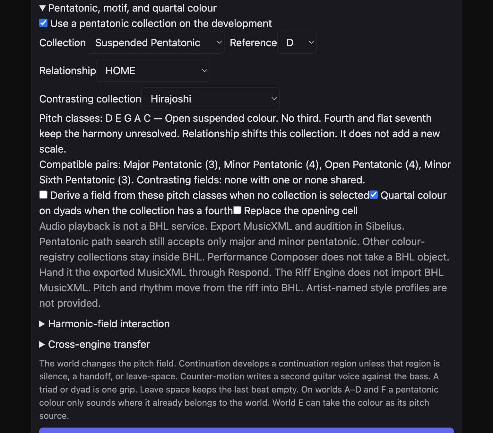

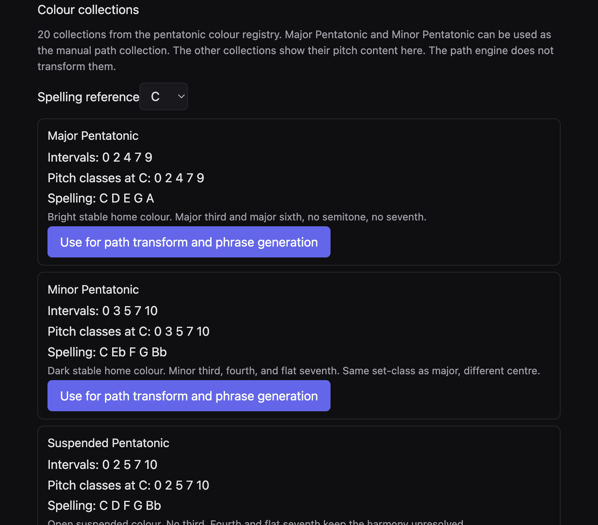

### Scenario 19. Major pentatonic as a bright home {#s19}

#### Musical aim {#s19a}

A stable, open colour: major third and major sixth, no semitone, no seventh.

#### Starting material {#s19b}

World E, or a world whose field already contains those pitches.

#### BHL settings {#s19c}

- World E.
- Collection: Major Pentatonic.
- Reference: the bass root, or C if you are spelling the registry.
- Relationship: HOME.
- Contrast: None.
- Approach: Colour-field composition.

#### Procedure {#s19d}

1. Tick the collection.
2. Read “Bright stable home colour” under the pitch classes.
3. Generate three candidates.

#### Expected musical result {#s19e}

On world E the major pentatonic is the pitch source. Dyads favour the open stacking of that set. No leading tone is required.

#### Variations {#s19f}

- The same collection on the Pentatonic page can be sent to path transform. Click Use for path transform and phrase generation. That step is the Pentatonic page, not BHL.
- Relationship MAJOR shifts the set by the menu’s offset. The name stays Major Pentatonic.

#### Limitations {#s19g}

On worlds A to D and F, pitches in the collection that the world lacks are left out. The page lists them after Generate.

### Scenario 20. Minor pentatonic as a dark home {#s20}

#### Musical aim {#s20a}

The same broad stability as major pentatonic, centred so the third is minor.

#### Starting material {#s20b}

World E.

#### BHL settings {#s20c}

- World E.
- Collection: Minor Pentatonic.
- Reference: match the bass.
- Relationship: HOME.
- Approach: Chamber lyricism.
- Density: single line.

#### Procedure {#s20d}

1. Set the collection.
2. Generate.
3. Compare with a saved major-pentatonic project of the same bass, if you made Scenario 19.

#### Expected musical result {#s20e}

A dark single line inside C Eb F G Bb, or the same intervals from your reference. The set-class matches major pentatonic. The centre does not. Lyricism keeps it melodic.

#### Variations {#s20f}

- Minor pentatonic can be sent to the Pentatonic page, as can the other eighteen colours.
- Contrast Major Pentatonic when you want the bright set in the development only.

#### Limitations {#s20g}

Do not treat the flat seventh as a dominant seventh that must fall. World E does not write that cadence.

### Scenario 21. Suspended colour, no third {#s21}

#### Musical aim {#s21a}

Harmony that will not decide major or minor. Fourth and flat seventh keep it open.

#### Starting material {#s21b}

World E. Reference chosen from the bass. The checked example used D.

#### BHL settings {#s21c}

- World E.
- Collection: Suspended Pentatonic.
- Reference: D.
- Relationship: HOME.
- Contrast: None.
- Approach: Colour-field composition.
- Quartal colour on dyads: on, because this set contains a fourth.

#### Procedure {#s21d}

1. Set D and Suspended.
2. Read the pitch classes. At D they are D E G A C.
3. Generate.
4. Read the constraint under Harmonic-field interaction.

#### Expected musical result {#s21e}

A pentatonic field with no third. Dyads can use the fourth. The harmony stays unresolved. This is a colour, not a sus chord on every beat waiting for a major triad.

#### Variations {#s21f}

- Add Hirajoshi as contrast. Scenario 23.
- On world A, the same collection only contributes pitches the two triads already own.

#### Limitations {#s21g}

On the Pentatonic page this row has the same path button as the other colours. That does not remove it from BHL.

### Scenario 22. Open pentatonic, no third and no seventh {#s22}

#### Musical aim {#s22a}

Still more open than suspended: no third, and no seventh either. Common tones without a decision.

#### Starting material {#s22b}

World E.

#### BHL settings {#s22c}

- World E.
- Collection: Open Pentatonic.
- Reference: C, or the bass.
- Relationship: HOME.
- Quartal colour: on.
- Dialogue: leave space.

#### Procedure {#s22d}

1. Select Open Pentatonic.
2. Read C D F G A if the reference is C.
3. Generate a single guitar before you store three candidates.

#### Expected musical result {#s22e}

Dyads and single notes from a set that will not declare mode. Leave-space keeps the last beat empty so the openness is not filled in by rhythm.

#### Variations {#s22f}

- Suspended Pentatonic puts the flat seventh back, which is a darker open sound.
- Major Pentatonic puts the third back and ends the ambiguity.

#### Limitations {#s22g}

On the Pentatonic page, Open Pentatonic can be the manual path collection. Inside BHL it remains a development colour.

### Scenario 23. Kumoi, then Hirajoshi {#s23}

#### Musical aim {#s23a}

Two Japanese-derived colours. Kumoi is softer. Hirajoshi is more fragile, with a flat sixth.

#### Starting material {#s23b}

World E.

#### BHL settings {#s23c}

- World E.
- Collection: Kumoi.
- Reference: D.
- Relationship: HOME.
- Contrasting collection: Hirajoshi.
- Phrase development: recall the cell on the return.

#### Procedure {#s23d}

1. Set Kumoi against Hirajoshi.
2. Confirm the span has a development or transformation region. The lock receipt and the region headings show this.
3. Generate.
4. If the page says the contrast was not applied, the span had no such region.

#### Expected musical result {#s23e}

The statement can live in Kumoi. The development can move to Hirajoshi. Recall tries to bring the cell back. Both sets are real BHL colours. A verified repair used suspended D as the source and Hirajoshi as the contrast, and kept the return inside the selected collection.

#### Variations {#s23f}

- Swap them: Hirajoshi first, Kumoi as the contrast, for a dark opening and a softer answer.
- In Sen and Iwato are the harsher pair. Scenario 24.

#### Limitations {#s23g}

A contrast with no development or transformation region is reported and not applied. Do not expect the second colour in a span that is only a statement.

### Scenario 24. In Sen, then Iwato {#s24}

#### Musical aim {#s24a}

A suspended edge, then a colour with no perfect fifth.

#### Starting material {#s24b}

World E.

#### BHL settings {#s24c}

- World E.
- Collection: In Sen.
- Reference: C.
- Contrast: Iwato.
- Approach: Angular modern jazz.
- Continuation: fragment the motif.

#### Procedure {#s24d}

1. Read In Sen at C: C Db F G Bb. No third.
2. Read Iwato: C Db F Gb Bb. Flat five, no perfect fifth.
3. Generate three candidates.

#### Expected musical result {#s24e}

In Sen keeps a fifth and a fourth, so it can still feel suspended. Iwato removes the perfect fifth. Fragmentation stops the ear treating either set as a scale to run.

#### Variations {#s24f}

- Phrygian Pentatonic keeps the fifth and adds a minor third, a different dark edge.
- Relationship HOME only, so you hear the sets and not a shift.

#### Limitations {#s24g}

Iwato is unstable on purpose. Do not ‘fix’ a generated line by adding a perfect fifth in another editor and calling it the same colour.

### Scenario 25. Blue pentatonic, the fifth replaced {#s25}

#### Musical aim {#s25a}

Minor-pentatonic darkness with a flat five where the fifth was. A colour, not a blues chorus.

#### Starting material {#s25b}

World E.

#### BHL settings {#s25c}

- World E.
- Collection: Blue Pentatonic.
- Reference: the bass.
- Approach: Rhythmic counterpoint.
- Rhythm: syncopate.
- Outside colour: off.

#### Procedure {#s25d}

1. Select Blue Pentatonic.
2. Read the intervals 0 3 5 6 10.
3. Generate.
4. Look for Gb against C, or the same tritone from your reference, instead of a perfect fifth.

#### Expected musical result {#s25e}

The flat five is inside the collection, so it is not an outside tone. Syncopation and a second voice can worry that interval without a scale run. There is no blues form and no turnaround in this world.

#### Variations {#s25f}

- Minor Pentatonic puts the perfect fifth back.
- Remote Altered is harsher and keeps fewer tones in common with a diatonic bass.

#### Limitations {#s25g}

Accents are not imported from riff data. If you wanted a pushed accent, it must come from the rhythm menu or the riff’s own attacks, not from an articulation mark BHL does not have.

### Scenario 26. Both thirds in one field {#s26}

#### Musical aim {#s26a}

Major and minor unresolved, together, plus fifth and flat seventh.

#### Starting material {#s26b}

World E.

#### BHL settings {#s26c}

- World E.
- Collection: Ambiguous Third.
- Reference: C.
- Approach: Colour-field composition.
- Density: dyad.
- Contrast: None.

#### Procedure {#s26d}

1. Select Ambiguous Third.
2. Read C Eb E G Bb.
3. Generate dyads.
4. Do not choose a collection that deletes one of the thirds until you have saved this project.

#### Expected musical result {#s26e}

A dyad can hold Eb and E, or one of them with G. The field refuses to vote. That is the aim. A later continuation can still sequence inside the same five notes.

#### Variations {#s26f}

- Leading-Tone Major keeps only the major third and adds B, a different kind of pull.
- Open Pentatonic deletes both thirds.

#### Limitations {#s26g}

Five notes that include both thirds are still one collection. BHL will not split them into two keys.

### Scenario 27. A leading tone that is not a cadence {#s27}

#### Musical aim {#s27a}

Major colour with a leading tone instead of the sixth. The pull is colour, not a perfect cadence.

#### Starting material {#s27b}

World E.

#### BHL settings {#s27c}

- World E.
- Collection: Leading-Tone Major.
- Reference: C.
- Phrase development: follow the bass phrase.
- Continuation: hold, so the region’s own dialogue stays.
- Outside colour: off.

#### Procedure {#s27d}

1. Read C D E G B.
2. Generate.
3. See whether B appears as a colour beside the major triad tones, and whether the phrase still ends without a dominant-to-tonic formula.

#### Expected musical result {#s27e}

The leading tone pulls. The world does not write a cadence to satisfy it. Follow-the-bass keeps the guitar’s phrase with the bass’s phrase rather than inventing a classical close.

#### Variations {#s27f}

- Leading-Tone Minor uses Eb F G B from C: dark, with the same kind of pull.
- Major Pentatonic replaces B with A and the pull disappears.

#### Limitations {#s27g}

If you wanted an actual perfect cadence, this handbook cannot give it. None of the six worlds is that cadence.

### Scenario 28. Remote altered, few common tones {#s28}

#### Musical aim {#s28a}

A colour that shares little with a plain major or minor home: flat two, major third, flat five, flat seventh.

#### Starting material {#s28b}

World E, or a filter test on world A.

#### BHL settings {#s28c}

- First: World E, collection Remote Altered, reference C, contrast None, approach Spacious abstraction.
- Second, only after saving: World A, the same collection, to see the filter.

#### Procedure {#s28d}

1. Generate on world E and save.
2. Lock a copy on world A with the same collection.
3. Read Harmonic-field interaction on both.

#### Expected musical result {#s28e}

On world E the remote set is the pitch source, so the guitar may sound distant and still be correct. On world A the same set only contributes pitches the triads already contain. The rest are named and left out. The guitar stays on the world when the intersection is empty.

#### Variations {#s28f}

- Iwato is another low-intersection colour, without the major third.
- A contrasting collection of Major Pentatonic against Remote Altered maximises the distance, if a development region exists.

#### Limitations {#s28g}

Do not expect world A to ‘play Remote Altered’. The filter is the point of this second lock.

### Scenario 29. Shift a collection without adding a scale {#s29}

#### Musical aim {#s29a}

The same five intervals, moved. HOME, MAJOR, 6/9 SUSPENDED, MAJOR 7 COLOUR, or SUSPENDED.

#### Starting material {#s29b}

Any one collection you already understand. Major Pentatonic is the clearest.

#### BHL settings {#s29c}

- Collection: Major Pentatonic.
- Reference: C.
- Relationship: HOME, first.
- Then relationship: SUSPENDED.
- World E.
- Save the HOME project before you change the relationship.

#### Procedure {#s29d}

1. Generate and save under one project id.
2. Change only the relationship.
3. Lock if the page asks.
4. Generate again into a new project id.
5. Compare the pitch-class line on the page. The intervals match. The spelling has moved.

#### Expected musical result {#s29e}

SUSPENDED shifts the collection by seven semitones. MAJOR shifts by minus three. 6/9 SUSPENDED shifts by two. MAJOR 7 COLOUR shifts by four. HOME shifts by nothing. The menu does not create a new collection.

#### Variations {#s29f}

- Use the shift to follow a bass that has moved, instead of picking a different colour.
- A contrast collection is a different five-note set. A relationship is not.

#### Limitations {#s29g}

The compatible-pair list is recalculated from the shifted pitch classes. Read it again after you change the relationship.

### Scenario 30. A colour filtered by world C {#s30}

#### Musical aim {#s30a}

Hear only the part of a pentatonic set that major-plus-augmented already owns.

#### Starting material {#s30b}

World C, locked. Collection with some, not all, pitches inside that field. Lydian Pentatonic is a clear test: it has a major third and a sharp four, and no perfect fifth.

#### BHL settings {#s30c}

- World C.
- Collection: Lydian Pentatonic.
- Reference: the bass root.
- Relationship: HOME.
- Approach: Colour-field composition.

#### Procedure {#s30d}

1. Generate.
2. Read the constraint. It should name world C and say which pitches are shared and which are left out.
3. Confirm the message does not relabel the colour as major pentatonic.

#### Expected musical result {#s30e}

The guitar may use the shared tones, including the major third and, where the augmented field already has it, the raised colour. Pitches the world lacks stay out. The collection’s name remains Lydian Pentatonic.

#### Variations {#s30f}

- Whole-Tone Pentachord is a sterner filter: symmetrical, no perfect fifth.
- The same collection on world E would sound entire. Save that as another project.

#### Limitations {#s30g}

An unknown collection id fails. The page does not substitute major or minor. You will not see that failure from the menu, which only lists real ids.

### Scenario 31. When nothing is shared {#s31}

#### Musical aim {#s31a}

A colour and a world with an empty intersection. The guitar must stay on the world.

#### Starting material {#s31b}

World F, the tritone relationship, plus a remote colour.

#### BHL settings {#s31c}

- World F.
- Collection: Remote Altered.
- Reference: a note you suspect will miss the triads. Read the pairs on the page.
- If the pair list says the world tones and the colour share nothing, keep going.
- Approach: Chamber lyricism.

#### Procedure {#s31d}

1. Generate.
2. Read Harmonic-field interaction.
3. The guitar should remain on the world field.

#### Expected musical result {#s31e}

No snap to major pentatonic. No snap to minor. The colour is reported as unused where it shares nothing. The lyric line is made from the unrelated triads alone.

#### Variations {#s31f}

- Change only the world to E and generate a refined family in a new project. World E will play the remote set.
- Pick a compatible collection, three or more shared classes, when you want the colour to be audible on worlds A to D or F.

#### Limitations {#s31g}

The pair counts on the page are about collections against each other, not automatically about the world field. The world test is the constraint after Generate.

### Scenario 32. Quartal dyads, and the path page {#s32}

#### Musical aim {#s32a}

Use a fourth when the collection has one, then send that colour to the Pentatonic page.

#### Starting material {#s32b}

World E. A collection with a fourth, such as Suspended or In Sen.

#### BHL settings {#s32c}

- World E.
- Collection: Suspended Pentatonic or In Sen.
- Quartal colour on dyads when the collection has a fourth: on.
- Density: dyad.
- Then, separately, open the Pentatonic page.

#### Procedure {#s32d}

1. Generate the dyads in BHL.
2. On the Pentatonic page, set Spelling reference to D.
3. Find Suspended Pentatonic.
4. Click Use for path transform and phrase generation.
5. Set the collection-step bounds and click Generate path. A return home needs at least 3 steps.

#### Expected musical result {#s32e}

In BHL, a dyad may take the fourth. On the Pentatonic page, Suspended Pentatonic can be the manual path collection. M-DEG and M-NEAR use that collection. An unknown id is refused and is not rewritten as minor pentatonic.

#### Variations {#s32f}

- Turn quartal colour off when the fourth is making every dyad sound like the same grip.
- Minor Sixth Pentatonic has no perfect fourth as its identity. Quartal colour will not invent one.

#### Limitations {#s32g}

Length counts collection steps, including the start. A repeated collection counts as a step. Save project keeps the route. Reopen project loads it and does not write a new path.

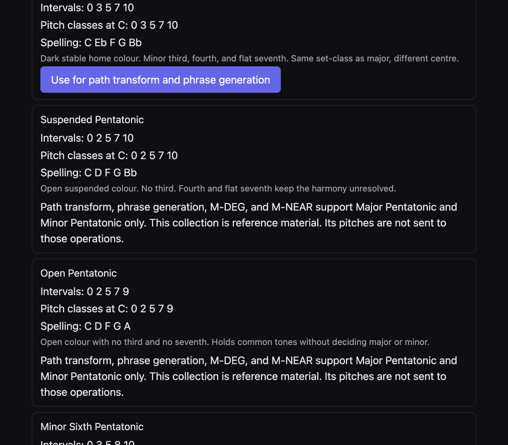

## D. Motif and riff development {#motif}

Pitch and rhythm are chosen apart. **Riff contour** takes intervals from the riff cell. **BHL world pitches** takes pitches from the world. The rhythm menu then decides whether the attacks are BHL’s, the same cell’s, another cell’s, or a multi-bar engine cell. Transformations stretch, cut, shift, or rest that rhythm. Leave-space, handoff, silence, and protected bars win.

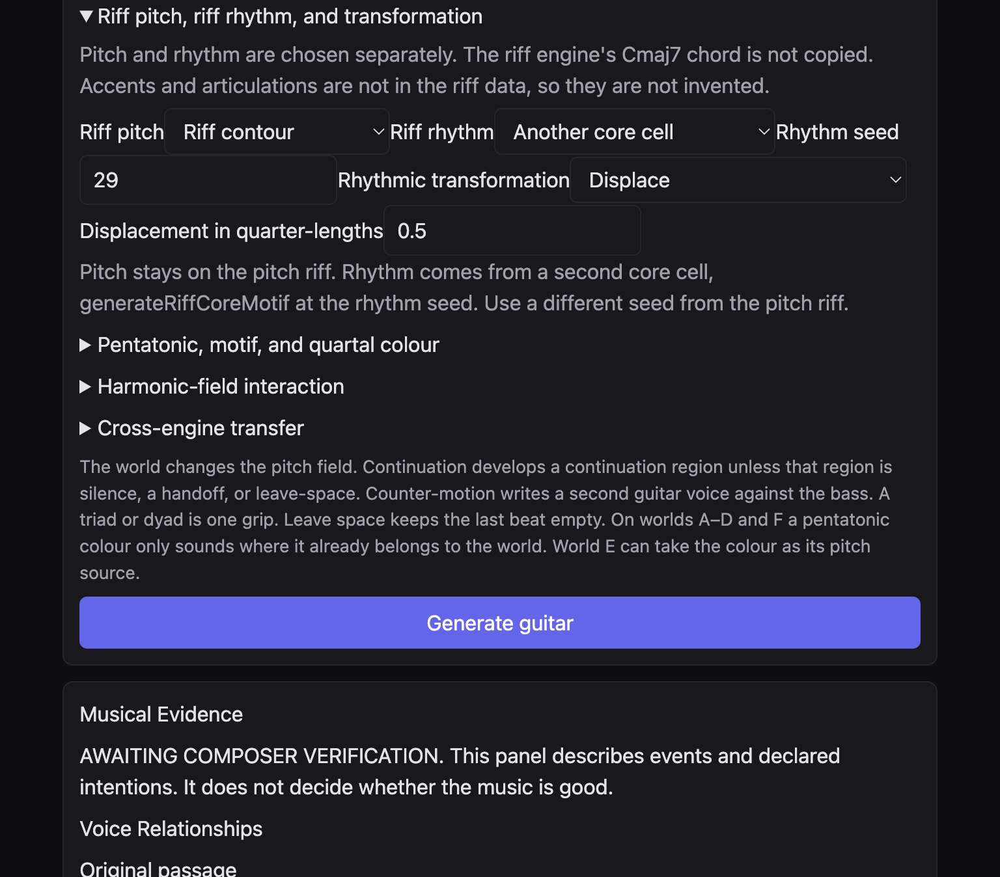

### Scenario 33. Keep the world’s pitches, take the riff’s rhythm {#s33}

#### Musical aim {#s33a}

The harmony stays BHL. The attacks come from the cell.

#### Starting material {#s33b}

A locked span.

#### BHL settings {#s33c}

- Riff pitch: BHL world pitches.
- Riff rhythm: This riff’s rhythm.
- Rhythmic transformation: Continue — repeat the cell.
- Rhythm seed: hidden, and unused.
- Approach: your choice. Colour-field if you want dyads on those attacks.

#### Procedure {#s33d}

1. Set pitch to world and rhythm to this riff.
2. Generate.
3. Compare with a second generate that uses BHL rhythm. Save both projects.

#### Expected musical result {#s33e}

Pitches stay in the world or the selected collection. Attacks follow the riff cell and, with Continue, return. The internal Cmaj7 of the riff engine is not written as a chord symbol.

#### Variations {#s33f}

- Original instead of Continue states the rhythm once.
- Another core cell, Scenario 60, uses a different rhythm from a second seed.

#### Limitations {#s33g}

This riff’s rhythm ignores the rhythm seed. If two seeds seem to do nothing, you are on this setting, not on Another core cell.

### Scenario 34. Keep a contour, change the pitch field {#s34}

#### Musical aim {#s34a}

The intervals of the riff survive. The world retunes them.

#### Starting material {#s34b}

Locked span. Two worlds you care about, saved separately.

#### BHL settings {#s34c}

- Riff pitch: Riff contour.
- Riff rhythm: BHL rhythm.
- Transformation: Continue.
- First project: world A.
- Second project: world E, with a collection.

#### Procedure {#s34d}

1. Generate world A and save.
2. Change to world E, set the collection, lock if required, generate, save under a new id.
3. The contour should be recognisable. The pitch classes should differ.

#### Expected musical result {#s34e}

A verified pair of examples, same rhythm and Continue, differed in pitch between world A and world E. Bar 34 was one place the pitches diverged. Your seeds will not duplicate that bar unless you repeat that exact setup. The principle is the same: contour held, field changed.

#### Variations {#s34f}

- Invert the motif after Replace the opening cell, if you want the contour upside down.
- BHL world pitches abandons the contour. Use that when the world matters more than the riff’s shape.

#### Limitations {#s34g}

The contour is one cell. Original will not tile it across the phrase.

### Scenario 35. Keep the rhythm, change the pitches {#s35}

#### Musical aim {#s35a}

The attacks stay. The notes move inside the field.

#### Starting material {#s35b}

A locked phrase with a continuation region that is not silence, handoff, or leave-space.

#### BHL settings {#s35c}

- Phrase continuation: keep the rhythm, change the pitches.
- Riff rhythm: BHL rhythm, so this continuation menu is the one writing attacks. If a riff rhythm is selected, it replaces this menu.
- Motivic development: reproject-neighbor.
- Collection on, if you want the new pitches inside a colour.

#### Procedure {#s35d}

1. Set continuation.
2. Generate.
3. Compare two candidates for the same attacks and different pitches. The pair readout may show equal attack counts. That is a clue, not a verdict.

#### Expected musical result {#s35e}

The rhythm of the region stays. Pitches move. On world E they should remain in the collection. Reproject-neighbor is the region’s way of parking a neighbour tone in a new place inside the field.

#### Variations {#s35f}

- Sequence the shape inside the field keeps more of the contour than a free repitch.
- Fragment the motif if the rhythm itself should shrink.

#### Limitations {#s35g}

Continuation does not rewrite silence, a handoff, or leave-space. If the whole span is those, this scenario has nothing to develop.

### Scenario 36. Displace the cell {#s36}

#### Musical aim {#s36a}

The same notes, late or early by a fraction of a beat. The cell grows. It is not trimmed to the bar.

#### Starting material {#s36b}

A locked 4/4 span is the clearest.

#### BHL settings {#s36c}

- Rhythmic transformation: Displace.
- Displacement in quarter-lengths: 0.5.
- Riff rhythm: This riff’s rhythm, or Another core cell.
- Dialogue: not leave-space, or the empty beat will win.

#### Procedure {#s36d}

1. Set 0.5.
2. Generate.
3. An attack that no longer fits bar 1 should appear whole in the next bar, not as a tied stump and not quantised.

#### Expected musical result {#s36e}

A checked handoff example shifted by 0.5 and moved the overflowing attack whole into the next bar. Your line will do the same kind of move. Leave-space, handoff, silence, and protected bars still override the grid.

#### Variations {#s36f}

- 0.25 is a smaller shove. The control accepts quarters in steps of 0.25.
- Augment is a different operation: durations double, rather than the cell sliding.

#### Limitations {#s36g}

A note finer than the division grid, or one that cannot cross the bar whole, is named and omitted.

### Scenario 37. Augment, twice as long {#s37}

#### Musical aim {#s37a}

The cell in slow motion. It will spill.

#### Starting material {#s37b}

A short cell you have already heard at Original.

#### BHL settings {#s37c}

- Transformation: Augment — twice as long.
- Pitch: Riff contour or world pitches.
- Approach: Chamber lyricism, so the long notes have air.
- Protected bars: none, or the spill cannot pass through them.

#### Procedure {#s37d}

1. Save an Original version.
2. Switch to Augment.
3. Generate.
4. In MuseScore 4, compare the two exports. Durations should double. The cell should cross a bar rather than be clipped.

#### Expected musical result {#s37e}

Twice the duration. The musical point is weight and spill, not a new melody. Lyricism stops the long notes from being harmonised on every beat.

#### Variations {#s37f}

- Diminish is the opposite. Scenario 38.
- Continue plus Augment repeats the long form. It can fill a phrase quickly. Use it only when you want an ostinato of long values.

#### Limitations {#s37g}

Protected guitar bars and silence windows block the spill. If the augment seems to vanish, check those first.

### Scenario 38. Diminish, twice as fast {#s38}

#### Musical aim {#s38a}

The cell in diminution. Values that become too fine are withheld, not quantised.

#### Starting material {#s38b}

A cell whose notes are not already the shortest the score can hold.

#### BHL settings {#s38c}

- Transformation: Diminish — twice as fast.
- A score whose divisions can hold the halved values. Wrong Turning’s guitar divisions are 4, a sixteenth if the beat is a crotchet divided in four. A quaver halved is a semiquaver and may fit. A semiquaver halved may not.
- Approach: Angular modern jazz.

#### Procedure {#s38d}

1. Generate.
2. If the page says the rhythm did not fit, every attack was too fine. Choose Original or Augment instead.
3. If it fits, the attacks are twice as fast and different from Original, Fragment, and Insert a rest.

#### Expected musical result {#s38e}

A faster cell, still the same pitches in order, with any illegal short note named and dropped. Angular attack placement keeps the result from sounding like a mechanical halving only.

#### Variations {#s38f}

- Fragment keeps the opening half instead of speeding everything.
- Another core cell at a new seed is a different rhythm, not a diminution of this one.

#### Limitations {#s38g}

If every attack is too fine, generation reports the failure. That report is the result. Do not quantise by hand and call it BHL.

### Scenario 39. Fragment, keep the opening {#s39}

#### Musical aim {#s39a}

The listener remembers the start of the cell. The tail is named and unused.

#### Starting material {#s39b}

A cell of more than a couple of notes.

#### BHL settings {#s39c}

- Transformation: Fragment — keep the opening.
- Continuation: fragment the motif, if you also want the phrase engine to agree.
- Dialogue: answer after bass.
- Approach: Spacious abstraction, optional, for a short high answer.

#### Procedure {#s39d}

1. Generate.
2. The unused tail should be reported, not sounded.
3. The sounding part is the opening half.

#### Expected musical result {#s39e}

A recognisable head of the motif, then stop. The answer after the bass can be that head alone. Space around it is the rhetoric.

#### Variations {#s39f}

- Insert a rest cuts duration out of a long note instead of discarding a tail.
- Original states the whole cell once, including the tail.

#### Limitations {#s39g}

Fragment and the continuation menu’s “fragment the motif” are related ideas on different controls. Set both if you want them to agree. Setting only one leaves the other menu in force.

### Scenario 40. Continue, so the cell can return {#s40}

#### Musical aim {#s40a}

An ostinato that is allowed. Repetition here is a choice, not an accident.

#### Starting material {#s40b}

A cell you want to recognise later in the phrase.

#### BHL settings {#s40c}

- Transformation: Continue — repeat the cell.
- Phrase development: recall the cell on the return.
- World E with a collection, so the return has a field to land in.
- Protected bars empty.

#### Procedure {#s40d}

1. Generate.
2. Find the cell more than once.
3. Recall on the return is the phrase engine’s own memory, in addition to the repeated rhythm.

#### Expected musical result {#s40e}

Onset plans are marked so a repeated grid is allowed. You should be able to find the cell again. Recall tries to put it on the return region as well. Together they make a motif you can recognise without a song form.

#### Variations {#s40f}

- Original is the control that stops the repetition.
- Displace plus Continue shifts every copy, so the ostinato is late rather than on the beat.

#### Limitations {#s40g}

A protected bar will not receive the ostinato. A silence window will not either.

### Scenario 41. Put a rest inside the cell {#s41}

#### Musical aim {#s41a}

Breath. Split a long enough note into note plus rest.

#### Starting material {#s41b}

A cell with a note of at least half a crotchet.

#### BHL settings {#s41c}

- Transformation: Insert a rest.
- Dialogue: leave space, if you also want the last beat empty. That is a second gap, not the same as this split.
- Approach: Chamber lyricism.

#### Procedure {#s41d}

1. Generate.
2. If the transform is reported unavailable, no note was long enough to split. Lengthen by Augment first, save, then try Insert a rest on that longer cell.

#### Expected musical result {#s41e}

The last note that is at least half a crotchet becomes note plus rest. The pitches stay. The breath is the point. Lyricism agrees with it.

#### Variations {#s41f}

- Leave space empties the last beat of the bar even when Insert a rest is off.
- Fragment discards a tail instead of resting inside it.

#### Limitations {#s41g}

If no suitable note exists, the transform is unavailable. The page should say so. Do not draw the rest in another program and call it this result.

### Scenario 42. State the cell once, then stop {#s42}

#### Musical aim {#s42a}

A motto. The rest of the phrase is bass, or silence, until you ask for more.

#### Starting material {#s42b}

Any locked span longer than the cell.

#### BHL settings {#s42c}

- Transformation: Original — state the cell once.
- Continuation: keep the region’s assigned dialogue.
- Do not tick Continue.
- Approach: Spacious abstraction or Chamber lyricism.

#### Procedure {#s42d}

1. Generate.
2. Confirm later bars do not repeat the cell.
3. If they do, Continue is still selected, or the phrase engine’s own recall is on. Turn recall off by choosing follow the bass phrase.

#### Expected musical result {#s42e}

One statement. Later bars silent unless another control fills them. A verified comparison showed Original stopping where Continue kept playing. Silence after the motto is success.

#### Variations {#s42f}

- Answer after bass lets a later region reply without repeating the whole cell.
- Replace the opening cell if the motto should be pitches you typed, not the world’s cell.

#### Limitations {#s42g}

Recall the cell on the return will bring material back. That contradicts “once” if you leave it on. Choose one.

### Scenario 43. An imported motto, inverted, then lifted in register {#s43}

#### Musical aim {#s43a}

Your own pitches, not the world’s cell, turned over and moved.

#### Starting material {#s43b}

Three or four pitches you are willing to type as MIDI numbers or as the page expects in the motif box. The control is a text field under Imported pitches.

#### BHL settings {#s43c}

- Replace the opening cell: on.
- Motif source: Imported pitches.
- Type the pitches.
- Transform: Invert. Generate and save.
- Then Transform: Register transfer. Generate into a new project.

#### Procedure {#s43d}

1. Tick Replace the opening cell.
2. Choose Imported pitches and enter them.
3. Invert.
4. Generate three candidates.
5. Change the transform to Register transfer and save a second project.

#### Expected musical result {#s43e}

The opening cell is no longer the world’s default. Inversion turns the intervals over. Register transfer moves that shape. The field still constrains where notes may land, especially on world E.

#### Variations {#s43f}

- Motif source Intervals lets you type interval numbers instead of pitches.
- Transpose asks for semitones. That third transform is only a shift, not an inversion.
- Existing riff generator as the motif source uses a riff seed of its own, separate from the rhythm seed.

#### Limitations {#s43g}

This motif panel is not the riff pitch menu. You can leave riff pitch on world pitches and still replace the opening cell. Read both panels before you generate, so you know which one you meant.

## E. Guitar and upright bass {#duo}

The bass is locked. The guitar converses. **Bass dialogue** on each region is the conversation: answer after bass, counter-motion, handoff before bass, or leave space. Density chooses single line, dyad, triad, alternate, or counterline. A triad or a dyad is one grip.

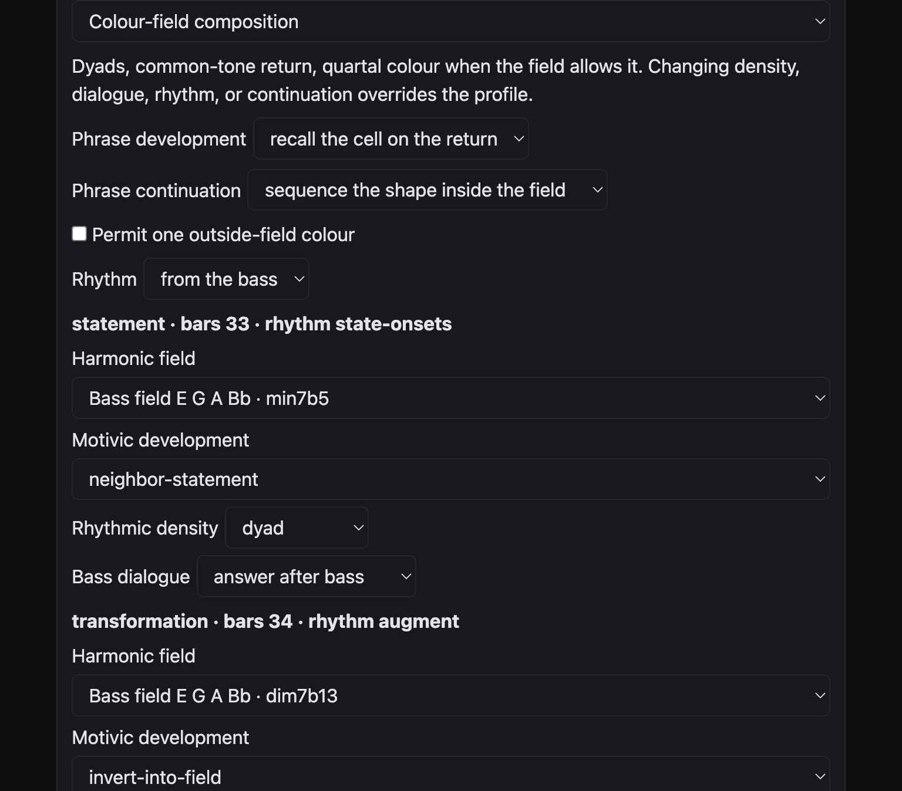

### Scenario 44. The bass speaks first {#s44}

#### Musical aim {#s44a}

The guitar waits, then answers. Call and response, with the bass leading.

#### Starting material {#s44b}

A locked duo. Bass notes already in the span.

#### BHL settings {#s44c}

- Dialogue: answer after bass.
- Approach: Chamber lyricism, which also leaves space, or set the dialogue yourself after No profile.
- Density: single line.
- Rhythm: from the bass.

#### Procedure {#s44d}

1. Set every region you care about to answer after bass.
2. Generate.
3. In MuseScore 4, the guitar entrance should not cover the bass attack it is answering.

#### Expected musical result {#s44e}

The bass moves. The guitar follows. Rhythm derived from the bass keeps the answer in the bass’s time. The locked bass notes are unchanged.

#### Variations {#s44f}

- Handoff is the opposite order: guitar first, then clear. Scenario 46.
- Counter-motion speaks at once. Scenario 45.

#### Limitations {#s44g}

A protected guitar bar will not become an answer. It stays the source.

### Scenario 45. A second guitar voice against the bass {#s45}

#### Musical aim {#s45a}

Counterpoint in one instrument: two guitar voices, the bass untouched.

#### Starting material {#s45b}

A locked span. At least one region that may take counter-motion.

#### BHL settings {#s45c}

- Approach: Rhythmic counterpoint, or set dialogue to counter-motion and density to counterline yourself.
- Rhythm: displace.
- Continuation: answer the bass.
- Protected guitar bars: empty, or the second voice will not enter there.

#### Procedure {#s45d}

1. Apply the approach.
2. Generate.
3. Export.
4. In MuseScore 4, look for a second guitar voice. A verified dialogue example placed that voice in later bars and left a protected bar’s first voice identical to the source.

#### Expected musical result {#s45e}

Voice 2 is the counterline. It does not change protected pitches, durations, or attacks. The bass part is the same file you locked. Displace keeps the second voice off the statement’s grid.

#### Variations {#s45f}

- Alternate density switches texture instead of holding two voices all the time.
- Leave space on a later region stops the counterline before the phrase ends.

#### Limitations {#s45g}

If you see only one voice, the region was not counter-motion, or it was protected, or it was a silence. The comparison panel prints a voice list. Use it.

### Scenario 46. Hand the bar to the bass {#s46}

#### Musical aim {#s46a}

The guitar leads, then gets out of the way before the bass attack.

#### Starting material {#s46b}

A bass with clear attacks.

#### BHL settings {#s46c}

- Dialogue: handoff before bass.
- Density: single line or dyad.
- Transformation: Original or Fragment, so the guitar part is short enough to hand off.

#### Procedure {#s46d}

1. Set handoff on the regions that precede a bass entrance.
2. Generate.
3. The guitar should shorten before the next bass attack.

#### Expected musical result {#s46e}

A clearance. The bass arrival is clean. This is the conversational opposite of covering the bass.

#### Variations {#s46f}

- Answer after bass reverses the order.
- Leave space clears the last beat even when there is no bass entrance to respect.

#### Limitations {#s46g}

Handoff will not lengthen a protected bar to make the clearance. Protection wins.

### Scenario 47. Leave the last beat empty {#s47}

#### Musical aim {#s47a}

A deliberate hole at the end of the bar. Silence as part of the sentence.

#### Starting material {#s47b}

Any metre with a last beat you can spare. 4/4 is obvious. 7/8 still has a last quaver.

#### BHL settings {#s47c}

- Dialogue: leave space.
- Approach: Spacious abstraction or Chamber lyricism.
- Rhythmic transformation may be Continue, but leave-space still wins.
- Outside colour: off.

#### Procedure {#s47d}

1. Set leave space.
2. Generate.
3. In MuseScore 4 the last beat of those bars should be empty in the guitar, even if the riff cell wanted a note there.

#### Expected musical result {#s47e}

The hole is structural. The riff does not fill it. The bass may still be sounding. The guitar’s refusal is the gesture.

#### Variations {#s47f}

- Insert a rest puts a hole inside the cell as well.
- A silence region, where the phrase plan has one, is a larger hole than one beat.

#### Limitations {#s47g}

You cannot leave-space a protected bar into a new shape. The source remains.

### Scenario 48. Sparse dyads {#s48}

#### Musical aim {#s48a}

Two notes, one grip, not a chord chart.

#### Starting material {#s48b}

World A, C, or E.

#### BHL settings {#s48c}

- Density: dyad.
- Approach: Colour-field composition.
- Quartal colour: on only if the collection has a fourth and you are on world E or the world allows it.
- Dialogue: answer after bass.

#### Procedure {#s48d}

1. Set dyad on the regions you want vertical.
2. Generate.
3. Read each dyad as a single object against the bass, with rests around it.

#### Expected musical result {#s48e}

Grips of two. Colour-field’s common-tone return can bring the same dyad back. The bass remains the foundation. The guitar is not comping.

#### Variations {#s48f}

- Triad density adds a third note to the grip. Scenario 49.
- Single line deletes the grip and leaves melody.

#### Limitations {#s48g}

A dyad is still checked for guitar feasibility. The candidate panel can warn about a fret span. That warning is technical. It is not a player’s approval.

### Scenario 49. A triadic gesture {#s49}

#### Musical aim {#s49a}

Three notes, once, as a gesture. Then line or silence.

#### Starting material {#s49b}

A world built from triads: A, C, D, or F.

#### BHL settings {#s49c}

- Density on one region: triad.
- The next region: single line.
- Dialogue: handoff before bass.
- World A or F.

#### Procedure {#s49d}

1. Set only the statement to triad.
2. Set the next region to single line.
3. Generate.
4. You should see one three-note grip, then a thinner answer.

#### Expected musical result {#s49e}

The triad states the world. The single line continues without another block chord. Handoff clears the grip before the bass. This is chamber writing.

#### Variations {#s49f}

- Alternate density lets the page mix grips without you setting each region.
- World E dyads are pentatonic stacks, not necessarily major triads.

#### Limitations {#s49g}

Feasibility warnings name bar, onset, MIDI numbers, and fret span. Read them. They do not rewrite the music.

### Scenario 50. Register and silence {#s50}

#### Musical aim {#s50a}

The guitar high, the bass low, and daylight between phrases.

#### Starting material {#s50b}

A locked duo.

#### BHL settings {#s50c}

- Approach: Spacious abstraction.
- That approach sets a high register, silence, and a short fragmented answer.
- Density: single line.
- Dialogue: leave space.
- Continuation: fragment the motif.

#### Procedure {#s50d}

1. Apply Spacious abstraction.
2. Do not then set density to triad, or you will override the approach.
3. Generate three candidates.
4. Pick the one with the most rests if space is the aim. The comparison counts rests and silences.

#### Expected musical result {#s50e}

High guitar, intact bass, short answers, empty beats. The distance between the staves is the orchestration. No extra instruments are created.

#### Variations {#s50f}

- Chamber lyricism is lower and more sustained, still sparse.
- Angular modern jazz will fill the same register with fragments and inverted contours.

#### Limitations {#s50g}

The approach’s register is a generation setting. The page does not draw a register diagram. Read the notes in MuseScore 4.

### Scenario 51. Mixed metre, the cell placed whole {#s51}

#### Musical aim {#s51a}

A phrase that already changes metre. The riff cell is still a four-beat cell. It is placed into each bar. It is not quantised, and it is not a mixed-metre cell from the riff engine.

#### Starting material {#s51b}

A score whose bars are not all the same length. A verified example runs 4/4, 5/4, 3/4, 7/8, and then the pattern again. The bass of that example stayed the source.

#### BHL settings {#s51c}

- Import that kind of file, or any file whose lock receipt shows differing metres.
- Riff rhythm: Multi-bar engine rhythm, or This riff’s rhythm.
- Rhythm seed: set it if the multi-bar engine is selected.
- Transformation: Continue or Original.
- Do not expect the engine to supply a 7/8 cell. It will not.

#### Procedure {#s51d}

1. Lock and read the metre line. Each bar’s beats and beat type should match the file.
2. Generate.
3. Export.
4. Open in MuseScore 4.
5. Check each bar adds up, and that a note which did not fit is absent rather than squeezed.

#### Expected musical result {#s51e}

Each bar keeps its own length. Guitar durations inside a verified mixed-metre file summed to the bar. The bass matched the source. The cell was still four beats long. Overflow moves whole or is omitted.

#### Variations {#s51f}

- BHL rhythm instead of a riff cell lets the Rhythm menu write the attacks, which can follow the bass in each metre.
- A new composition cannot change metre mid-piece. Build the mixed file elsewhere, then import it. BHL will not author the metre map from the beats box.

#### Limitations {#s51g}

The verified MuseScore page of the mixed-metre example clips the movement title at the left margin. That is an engraving fault of that export. The metres on the systems are still the thing to read. A note finer than the division grid is named and left out.

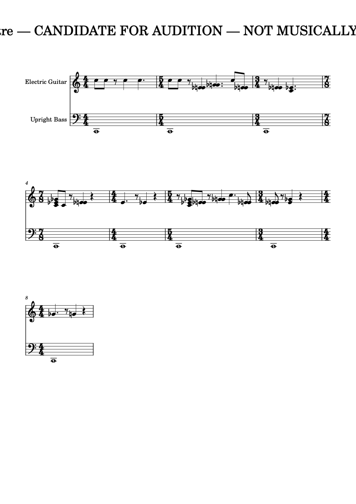

## F. Developing a score you already have {#existing}

Import locks a span. The bass stays. Protected guitar bars stay. Everything else in the span can be developed, compared, and refined without deleting the parent candidate. Save a project before you change world.

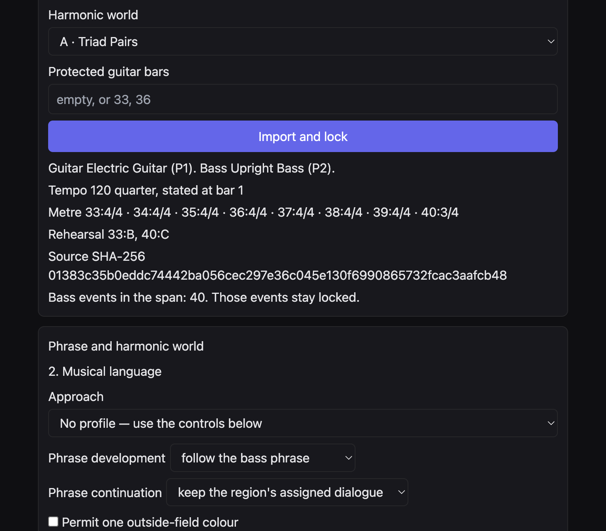

### Scenario 52. Keep the bass, rewrite the guitar {#s52}

#### Musical aim {#s52a}

A new guitar conversation on a bass you already believe.

#### Starting material {#s52b}

A duo MusicXML. Work on a copy if the original must remain byte-for-byte identical.

#### BHL settings {#s52c}

- Import the copy.
- Span: the bars you mean.
- Protected guitar bars: empty if the whole guitar span may change.
- World: the one you are testing.
- Seed noted in your project notes.

#### Procedure {#s52d}

1. Lock.
2. Read “Bass events in the span” and the sentence that those events stay locked.
3. Generate guitar.
4. Export beside the BHL export folder, not over the album file.

#### Expected musical result {#s52e}

The bass part matches the lock. The guitar in writable bars can differ. Outside the span, the verification says whether the source still matches. The source SHA-256 on a successful lock of the checked Wrong Turning file is the long number printed on the page. Your own file will print its own number.

#### Variations {#s52f}

- Protect the guitar melody and let only later bars change. Scenario 6.
- Three worlds means three projects, not three candidates. Candidates share one world and differ by seed.

#### Limitations {#s52g}

Do not export on top of a protected album file. The page writes exports to its export directory. The source stays put only if you do not later copy the export over it yourself.

### Scenario 53. Three candidates, then a pair {#s53}

#### Musical aim {#s53a}

Hear three seeds with the eye. Compare two at a time. Refuse a numerical winner.

#### Starting material {#s53b}

A locked span.

#### BHL settings {#s53c}

- All musical controls set before you click.
- Generate three candidates.
- Compare stored candidates.
- Select a different row and compare again if you want the third line in a pair.

#### Procedure {#s53d}

1. Generate the three.
2. Leave the first selected.
3. Compare. Read attacks, rests, voices, silences.
4. Select the third.
5. Compare again.

#### Expected musical result {#s53e}

Three stored lines. Each comparison is the selected line against one other. A checked session compared Candidate 1 with Candidate 2 and said the analysis is provisional. There is no score and no automatic winner.

#### Variations {#s53f}

- Refine the line whose silence matches your aim, not the line with the most notes.
- Change the seed on the import panel and lock again only when you want a new family. The three candidates already carry their own seeds.

#### Limitations {#s53g}

Comparison uses the stored MusicXML. It does not generate a fourth line. If the controls have changed, the page can mark a candidate stale.

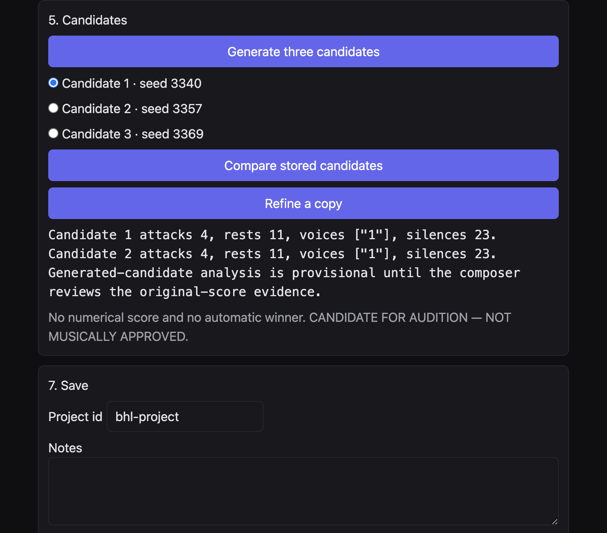

### Scenario 54. Refine without losing the parent {#s54}

#### Musical aim {#s54a}

A child line that remembers which candidate it came from.

#### Starting material {#s54b}

At least one selected candidate.

#### BHL settings {#s54c}

- A candidate selected.
- Refine a copy.
- Do not delete the parent. The page does not delete it.
- Project notes: say what you changed before the refine, if you changed anything.

#### Procedure {#s54d}

1. Select Candidate 1.
2. Click Refine a copy.
3. Read the new row. It should name the parent.
4. Confirm the original row is still there.

#### Expected musical result {#s54e}

A checked refine produced “Candidate 1 refined · seed 3341 · refined from Candidate 1” and the status “Refined candidate added. The original is still in the list.” Your seeds may differ. The parent relationship should be visible.

#### Variations {#s54f}

- Refine the refined row if you want a grandchild. The new row should name its own parent.
- Save after the first refine so a reopen restores the family.

#### Limitations {#s54g}

Refine is not an arrangement for a third instrument. The duo remains guitar and bass.

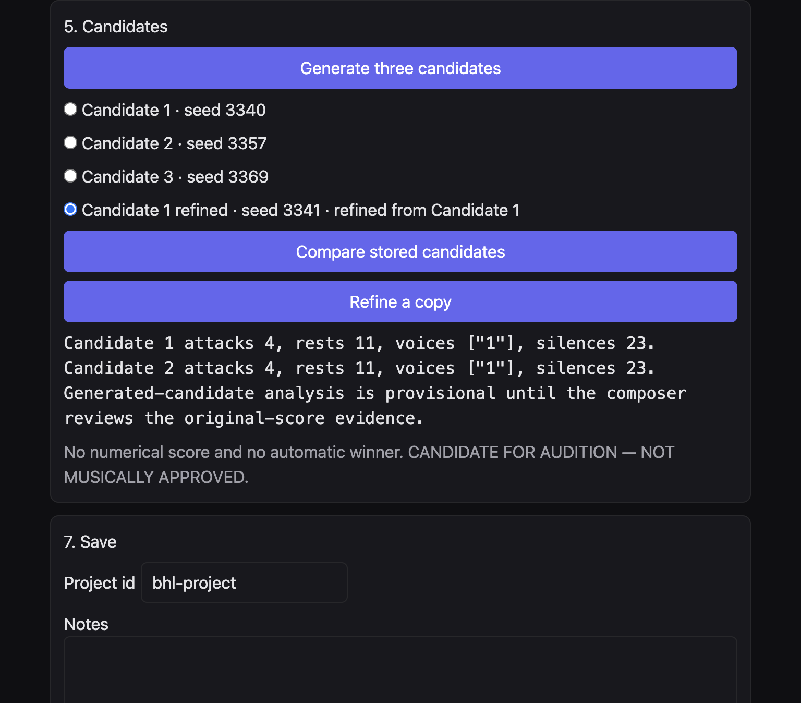

### Scenario 55. Save, close, and find the same world again {#s55}

#### Musical aim {#s55a}

Tomorrow’s session must restore the world, the riff choice, and the contrast, not only the notes.

#### Starting material {#s55b}

At least one candidate. A path you can find again.

#### BHL settings {#s55c}

- Project id: a musical name, not a date alone.
- Notes: world, collection, reference, contrast, riff pitch, riff rhythm, transformation.
- Save project.
- Project path: the file the button will reopen.

#### Procedure {#s55d}

1. Save.
2. Note the path printed.
3. Later, paste that path and click Reopen project.
4. Check harmonic world, collection, contrast, and riff menus against your notes.

#### Expected musical result {#s55e}

Reopen restores the locked source and the saved harmonic world. A verified project format stores the riff choice and the contrast id. The controls should show them again.

#### Variations {#s55f}

- Two project ids for two worlds of the same span.
- The notes field is the place to write “do not replace the parent”.

#### Limitations {#s55g}

Save project stays disabled until a candidate exists. Reopen stays disabled until the path box has text. The web page will not browse to the file for you.

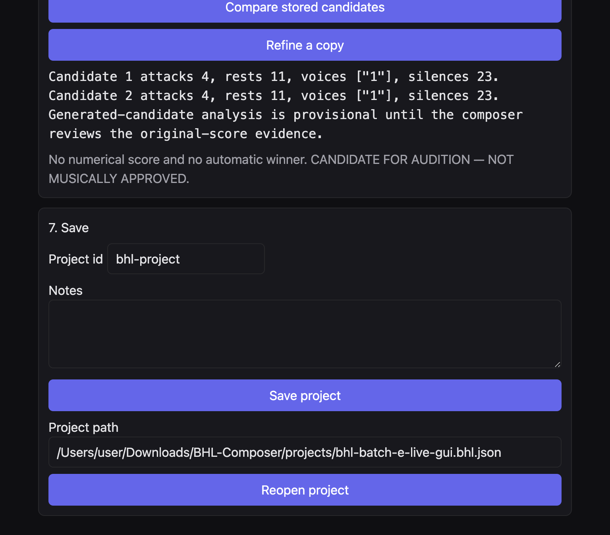

### Scenario 56. Change the span, then lock again {#s56}

#### Musical aim {#s56a}

A longer or shorter phrase, without generating on a stale lock.

#### Starting material {#s56b}

An existing lock.

#### BHL settings {#s56c}

- From bar and To bar: the new span.
- Protected guitar bars: revise them if the old numbers fall outside.
- Do not click Generate until the relock message is gone.

#### Procedure {#s56d}

1. Change the span.
2. Read the message that bar span, path, or protected bars changed.
3. Import and lock.
4. Generate.

#### Expected musical result {#s56e}

The new lock is the span that will be written. The previous candidate is not silently updated. It can be marked stale once controls differ. Generate after the new lock.

#### Variations {#s56f}

- Changing only the approach does not require a new lock.
- Changing the MusicXML path does. You are then on another file.

#### Limitations {#s56g}

A span that runs past the end of the file will not lock cleanly. Shorten it to the last real bar.

### Scenario 57. One outside tone, then home {#s57}

#### Musical aim {#s57a}

A single foreign colour, and a return that still belongs.

#### Starting material {#s57b}

World E with a collection, so “home” is unambiguous.

#### BHL settings {#s57c}

- World E.
- Collection selected.
- Permit one outside-field colour: on.
- Phrase development: recall the cell on the return.
- Transformation: Continue or Original.

#### Procedure {#s57d}

1. Generate.
2. Read resource limitations if any are listed.
3. The return should be inside the collection.
4. If the page says a semitone could not be kept, accept the report.

#### Expected musical result {#s57e}

At most one outside tone in the development. The return lands in the collection when that is possible. The report, when a semitone will not fit, is the musical limit made visible. Forcing the semitone would lie about the colour.

#### Variations {#s57f}

- Outside colour off is the stricter poem.
- On worlds A to D and F the outside tick still cannot paint pitches the world refuses. Read the constraint.

#### Limitations {#s57g}

This is not a modulation plan. One tone is not a new key.

## G. Integration with the rest of Composer OS {#integrate}

BHL’s **Cross-engine transfer** panel is the honest list. Direct integration means the choice is made on the BHL page and the engine is called from there. It does not mean a second window opens. File transfer means you export MusicXML and open that file somewhere else.

| From | Into | How | Status |
| --- | --- | --- | --- |
| Riff cell | BHL pitch and rhythm | Menus on the BHL page | Working, direct |
| Second core cell | BHL rhythm only | Another core cell, plus rhythm seed | Working, direct |
| Multi-bar rhythm | BHL rhythm | Multi-bar engine rhythm | Working, direct |
| Twenty colours | BHL development | Collection menu | Working, direct |
| All twenty colours | Pentatonic path and phrase | Use for path transform… | Working on that page |
| Vault field | A BHL region | Harmonic field menu | Partial. Not the vault screen |
| Liquid harmony | World B | The world itself | Working, direct |
| BHL | Performance Composer | Export MusicXML, then Respond | File only |
| BHL | Riff Engine | No import | Not supported |

### Scenario 58. Choose a harmonic field on the region {#s58}

#### Musical aim {#s58a}

The bass field, or another vault field the menu offers, as the local colour of one phrase.

#### Starting material {#s58b}

A lock that shows Harmonic field on each region.

#### BHL settings {#s58c}

- Harmonic field: read the labels. One will be the bass field.
- World B if you want liquid harmony’s quadratonic in particular.
- Any other world if you only want that world’s triads or pentatonic set.
- Do not leave the BHL page looking for a fretboard.

#### Procedure {#s58d}

1. Open a region.
2. Choose a field.
3. Generate.
4. Open Cross-engine transfer.
5. The vault choice should be listed as direct.

#### Expected musical result {#s58e}

The menu is the integration. A different field changes the pitch source for that region inside the world’s rules. You do not import a vault object, and you do not get tablature.

#### Variations {#s58f}

- Leave every region on the bass field when the bass is the harmony you trust.
- World B plus a non-bass field is the more remote quadratonic.

#### Limitations {#s58g}

The full Tonality Vault product is another surface. BHL does not embed its fretboard, its tab, its microscope, or its iReal import. This handbook has no guitar tablature.

### Scenario 59. Liquid harmony, which is world B {#s59}

#### Musical aim {#s59a}

Three chord tones and a tension, planned as liquid harmony, without a button of that name.

#### Starting material {#s59b}

A locked bass.

#### BHL settings {#s59c}

- Harmonic world B · Harmonic Quadratonics.
- No other liquid-harmony control exists.
- Collection optional, as a filter.
- Cross-engine transfer after generate.

#### Procedure {#s59d}

1. Lock world B.
2. Generate.
3. Read the transfer text. It should call liquid harmony direct.

#### Expected musical result {#s59e}

The tension tone is the contrast. The chord tones are the common tones. That is the liquid motion this page can do.

#### Variations {#s59f}

- Scenario 9 keeps the chord tones quiet. Scenario 10 features the tension.
- Worlds A and F are triadic and are not liquid harmony, even if a field menu is present.

#### Limitations {#s59g}

Do not look for a Liquid Harmony page to launch from BHL. The panel says liquid harmony is world B.

### Scenario 60. A second rhythmic cell {#s60}

#### Musical aim {#s60a}

Pitches from the first riff. Rhythm from another cell, at another seed.

#### Starting material {#s60b}

Locked span.

#### BHL settings {#s60c}

- Riff pitch: Riff contour.
- Riff rhythm: Another core cell.
- Rhythm seed: a different number from the page seed. The page says to use a different seed from the pitch riff.
- The checked examples found that one seed can accidentally share the pitch riff’s rhythm. If the attacks do not differ, change the rhythm seed.
- Transformation: Continue or Original.

#### Procedure {#s60d}

1. Set Another core cell.
2. Set a rhythm seed.
3. Generate.
4. If the rhythm matches the pitch cell, change the rhythm seed and generate again.

#### Expected musical result {#s60e}

Two cells. Pitch from one, attacks from the other. A verified file used pitch seed 17 and rhythm seed 1 so the attacks would differ. Seed 29 happened to share the seed-17 rhythm, so it was a bad contrast. Your numbers will differ. The test is whether the attacks differ.

#### Variations {#s60f}

- This riff’s rhythm is the control that refuses a second seed.
- Multi-bar engine rhythm is a longer grid, not a second core cell.

#### Limitations {#s60g}

Generate three candidates keeps the rhythm seed. Candidate 1 keeps the transform you chose. The next two change that transform on the same cell, so the three lead rhythms are meant to differ. A checked run used Another core cell, pitch seed 17, rhythm seed 1, and Original, and the three lead rhythms differed. The source file was unchanged. Changing the page seed does not move that onset plan. If the second cell’s attacks match the pitch cell, change the rhythm seed. Seed 29 once shared the seed-17 rhythm.

### Scenario 61. A multi-bar rhythm inside the phrase {#s61}

#### Musical aim {#s61a}

Four bars of engine rhythm, sixteenth grid, medium, neutral, placed into your metre.

#### Starting material {#s61b}

A locked phrase, possibly mixed metre.

#### BHL settings {#s61c}

- Riff rhythm: Multi-bar engine rhythm.
- Rhythm seed: visible, and used.
- There is no stored second corpus riff and no riff id to type.
- Transformation: Continue if you want that four-bar grid to tile.
- Division grid of the score still applies.

#### Procedure {#s61d}

1. Select Multi-bar engine rhythm.
2. Set the seed.
3. Generate.
4. Read any note that was named and omitted.

#### Expected musical result {#s61e}

A neutral sixteenth grid, four bars of 4/4 in the engine, placed into the phrase you locked. Mixed metre keeps each bar’s length. The grid is not a quotation of a named riff in a library.

#### Variations {#s61f}

- Another core cell is shorter and comes from a second motif, not from this grid.
- BHL rhythm abandons the engine grid and follows the Rhythm menu.

#### Limitations {#s61g}

Accents and articulations are not in the data. They will not appear. A value the bar cannot hold is omitted, not quantised.

### Scenario 62. Hand a file to Performance Composer {#s62}

#### Musical aim {#s62a}

Continue in another Composer OS page, using notes, not a live BHL object.

#### Starting material {#s62b}

A candidate whose locks passed.

#### BHL settings {#s62c}

- Export MusicXML.
- Remember the path.
- Do not click Open in Sibelius.
- Leave BHL with the project saved.
- Open Performance Composer from the top row.
- Use Respond and choose the exported file.

#### Procedure {#s62d}

1. Export.
2. Save the BHL project first.
3. Click Performance Composer.
4. Respond, and choose the file.
5. Confirm you are looking at MusicXML, not at the .bhl.json project.

#### Expected musical result {#s62e}

Performance Composer reads the notes in the file. It does not receive the BHL world object, the candidate list, or the project. A later change in BHL will not update that page until you export again.

#### Variations {#s62f}

- MuseScore 4 is the place to read engraving. Performance Composer is a different musical tool. Use each for what it accepts.
- You can also open the same MusicXML in any notation host. BHL does not play it.

#### Limitations {#s62g}

There is no direct object handoff. If Respond will not take the .bhl.json file, that is correct. Choose the MusicXML.

### Scenario 63. What you should not try to connect {#s63}

#### Musical aim {#s63a}

A clear stop, so a later session does not invent a wire that is not there.

#### Starting material {#s63b}

Any BHL project.

#### BHL settings {#s63c}

- Do not import a BHL MusicXML into the Riff Engine and expect a round trip. The engine does not import BHL.
- Do not expect an unknown pentatonic id to become minor pentatonic. The page refuses it.
- Do not look for an artist-named approach.
- Do not look for audio inside BHL.
- Do not treat the 13 October desktop app as this page.

#### Procedure {#s63d}

1. Read Cross-engine transfer once.
2. Read the catalogue sentence in the pentatonic panel.
3. Stop at the refusals.

#### Expected musical result {#s63e}

The working directions are riff into BHL, colour into BHL, all twenty colours into the Pentatonic path page, vault field as a menu, liquid harmony as world B, and MusicXML out. The reverse riff import, artist profiles, and in-app audio are not supported.

#### Variations {#s63f}

- Hirajoshi and Iwato can be the manual path collection.
- All twenty remain legal as BHL development colours, subject to the world filter.

#### Limitations {#s63g}

The catalogue line that mentions Sibelius is stale for this project. Use MuseScore 4. Do not follow that sentence.

## H. Complete short projects {#projects}

These five projects combine settings you have already seen. Each is a piece you could take to MuseScore 4 and read. None is approved music. Save a project at the end of each, under its own id.

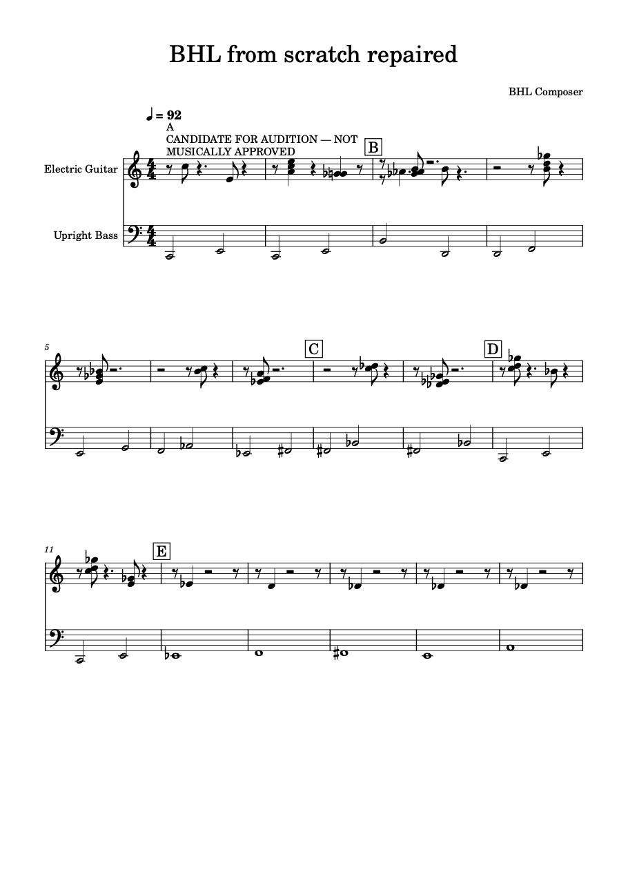

### Scenario 64. A guitar and bass miniature {#s64}

#### Musical aim {#s64a}

Sixteen bars, one colour, one motif, a quiet end.

#### Starting material {#s64b}

New composition, or the verified sixteen-bar file opened as a study.

#### BHL settings {#s64c}

- 16 bars, 4/4, tempo 92, seed 3340 if you want a known starting point.
- World E.
- Suspended Pentatonic, reference D, HOME, contrast Hirajoshi only if a development region appears after the lock.
- Approach: Chamber lyricism.
- Riff pitch: BHL world pitches.
- Riff rhythm: BHL rhythm.
- Transformation: Original, then a saved second pass with Continue if you want the cell to return.

#### Procedure {#s64d}

1. Create, lock, set the approach and the colour.
2. Generate three candidates.
3. Compare.
4. Refine the sparer one.
5. Save as miniature-suspended.
6. Export.
7. Open in MuseScore 4.

#### Expected musical result {#s64e}

A short suspended duo. The bass is long. The guitar is a line with room. Hirajoshi, if the phrase has a development, darkens the middle. Original keeps the motto to one statement. The verified picture in Figure 13 shows how sparse this duo can look, including an engraving collision you should expect on that particular file.

#### Variations {#s64f}

- World A for a triadic miniature instead.
- Protect bar 1 once the motto is right.

#### Limitations {#s64g}

Same seed and same controls repeat the guitar. If you change the contrast or the transformation, you have a new piece. Save it separately. The collision of the warning with the notes is a fault of that engraving, not a dynamic marking.

### Scenario 65. A reflective ballad {#s65}

#### Musical aim {#s65a}

Slow, high or sustained, no cadence, no drum feel.

#### Starting material {#s65b}

New score, slow tempo.

#### BHL settings {#s65c}

- Bars 16 or 32, beats 4, beat type 4, tempo 60.
- World E.
- Open Pentatonic or Suspended Pentatonic.
- Relationship HOME.
- Approach: Chamber lyricism or Spacious abstraction.
- Dialogue: leave space.
- Outside colour: off.
- Transformation: Augment, if you want the motto in long notes.

#### Procedure {#s65d}

1. Create and lock.
2. Apply the approach and do not override density.
3. Generate three candidates.
4. Choose by rest count and by whether the return sits in the collection.
5. Save as ballad-open.
6. Export and read in MuseScore 4 at the tempo mark.

#### Expected musical result {#s65e}

A slow duo. Open or suspended colour refuses a third. Leave-space refuses the last beat. Augment lengthens the motto until it spills, which at tempo 60 feels like breath rather than like a groove.

#### Variations {#s65f}

- 5/4 at the same tempo widens every bar. Scenario 4.
- Minor pentatonic makes the ballad darker without adding a seventh that functions.

#### Limitations {#s65g}

Thirty-two bars is still a song fragment. Do not expect a bridge form unless the bass phrase already has those regions. BHL does not invent lyrics or a chorus.

### Scenario 66. An asymmetric groove {#s66}

#### Musical aim {#s66a}

Seven quavers, a diminished colour, a fragmented guitar, the bass still locked and plain.

#### Starting material {#s66b}

New score in 7/8, or an imported 7/8 span.

#### BHL settings {#s66c}

- Beats 7, beat type 8, tempo 120, 16 bars.
- World D · Major + Diminished.
- Approach: Angular modern jazz.
- Rhythm: syncopate.
- Riff rhythm: BHL rhythm, for a predictable first pass.
- Transformation: Diminish only if the divisions can hold it. Otherwise Fragment.
- Collection: Blue Pentatonic as a filter, optional, after the first save.

#### Procedure {#s66d}

1. Create and lock.
2. Read the metre.
3. Generate three candidates with BHL rhythm.
4. Save.
5. Only then try Another core cell, and change the rhythm seed if the attacks do not differ.

#### Expected musical result {#s66e}

An uneven bar. World D supplies root, minor third, and tritone. Angular settings fragment and invert. Syncopation shifts the guitar inside the seven. The bass remains whatever the new score or the import locked.

#### Variations {#s66f}

- 5/8 is a tighter version of the same idea.
- Rhythmic counterpoint adds voice 2 if the groove needs an argument rather than a fragment.

#### Limitations {#s66g}

Do not quantise 7/8 into 4/4 in MuseScore after export and still call it this scenario. Another core cell keeps one rhythm seed across the three candidates and changes the transform. If the second cell matches the pitch cell, change the rhythm seed.

### Scenario 67. Two sections, one contrast {#s67}

#### Musical aim {#s67a}

A statement in one colour and a development in another, then a return you can recognise.

#### Starting material {#s67b}

A span whose region list, after locking, includes a statement and a development or transformation.

#### BHL settings {#s67c}

- World E.
- Collection: Kumoi or Suspended Pentatonic.
- Contrasting collection: Hirajoshi or Remote Altered.
- Phrase development: recall the cell on the return.
- Transformation: Continue.
- Approach: Colour-field composition.
- Protect the first bar if the statement must be literal.

#### Procedure {#s67d}

1. Lock and read the region names.
2. If you see no development, choose a longer span or a bass that phrases.
3. Set the contrast.
4. Generate.
5. Confirm the constraint mentions both colours.
6. Save.

#### Expected musical result {#s67e}

Section one keeps the first collection and, if you protected it, the original guitar. Section two may enter the contrast. The return tries to recall the cell inside the home collection. Continue makes the rhythm recognisable across the cut.

#### Variations {#s67f}

- World F for a triadic version of the same two-section plan, contrast coming from the tritone triad rather than from Hirajoshi.
- Fragment on the second section if the contrast should be shorter than the statement.

#### Limitations {#s67g}

No development region means the contrast is reported and unused. Lengthening the span is the remedy, not a second imaginary section control. There is no button named Section B.

### Scenario 68. A longer developmental span {#s68}

#### Musical aim {#s68a}

As long a duo as the page allows, still guitar and bass, still one world, with silence and a recalled cell.

#### Starting material {#s68b}

New composition at the long end, or a long imported span.

#### BHL settings {#s68c}

- Bars 64, or the longest span you can lock, beats 4, beat type 4, tempo 96.
- World E.
- Collection: Dorian Pentatonic.
- Contrast: Aeolian Pentatonic.
- Approach: Chamber lyricism for the outer regions. On a middle region only, set density to counterline and dialogue to counter-motion.
- Transformation: Continue.
- Phrase development: recall the cell on the return.
- Outside colour: off.
- Save before you override the middle region, so the pure lyric version remains.

#### Procedure {#s68d}

1. Create or import.
2. Lock.
3. Read how many regions the bass produced.
4. Generate three candidates on the lyric approach.
5. Save as long-dorian-lyric.
6. Then override one middle region to counter-motion.
7. Generate and save as long-dorian-counter.
8. Export either. Read it in MuseScore 4 in sections, not only at the first system.

#### Expected musical result {#s68e}

Up to sixty-four bars of one pentatonic world, with a contrasting collection where a development exists, a recalled cell, and optional two-voice writing in the middle. The bass stays locked. Silence from leave-space, if the approach set it, remains part of the length. This is as far as a single BHL canvas goes. It is not an orchestral score and not a multi-movement form.

#### Variations {#s68f}

- 32 bars is often enough. Sixty-four can become an ostinato unless Original replaces Continue.
- World B for the same length makes the long form liquid rather than pentatonic.

#### Limitations {#s68g}

Sixty-four bars will not grow extra players. Mixed metre will not appear unless the imported file already has it. A return that cannot keep a semitone inside Dorian or Aeolian will be reported. Candidate comparison is still a pair. Artistic approval is still not implied.

## Limits {#limits}

These limits are part of the instrument. Working inside them is the craft.

- No audio in BHL. Read MusicXML in MuseScore 4. Ignore the button labelled Open in Sibelius, and ignore the catalogue sentence that mentions Sibelius.
- No artist-named approaches.
- No guitar tablature, and no Tonality Vault fretboard inside BHL.
- No substitution of minor pentatonic when a colour id is unknown.
- No BHL object passed to Performance Composer. MusicXML only, then Respond.
- No BHL import into the Riff Engine.
- No quantise. Illegal notes are named and omitted.
- No automatic winner among candidates. Comparison is a pair.
- Another core cell does not make three rhythms by changing the page seed. The three candidates change the transform and keep the rhythm seed.
- Empty intersection between a colour and worlds A to D or F leaves the guitar on the world.
- A missing development region leaves a contrast unused.
- Protected bars and the bass win over riffs, counter-lines, and transformations.
- The installed desktop application of 13 October 2026 is not this page.
- The headings skip the numbers 3, 4, and 6.
- No generated file in this handbook is musically approved.

## Glossary {#glossary}

| Term | Meaning |
| --- | --- |
| Approach | Chamber lyricism, Angular modern jazz, Colour-field composition, Rhythmic counterpoint, or Spacious abstraction. |
| Collection | One of the twenty pentatonic colours. |
| Common tone | A pitch class kept across a move. |
| Contrast | The other triad, the tension tone, the tritone triad, or the contrasting collection. |
| Counter-motion | A second guitar voice against the bass. |
| Dialogue | Answer after bass, counter-motion, handoff before bass, or leave space. |
| Dyad / triad | One grip of two notes, or of three. Not a comping pattern. |
| Harmonic field | The region menu that carries a bass field or a vault choice. |
| HOME | Relationship offset zero. The collection unshifted. |
| Liquid harmony | World B. Not a separate button. |
| Lock | The recorded source. Bass events in the span stay. |
| Reference | The spelling note for a collection. |
| Relationship | A shift. Not a new scale. |
| Seed | Repeats a guitar when the other controls match. |
| World E | The collection is the pitch source. |
| Worlds A–D and F | Their own fields. A colour is a filter. |

The Quick Start Guide walks a first sixteen-bar piece in one sitting. This handbook is the catalogue of musical jobs around that sitting. When a control is missing from both books, it is missing because the page does not have it.

