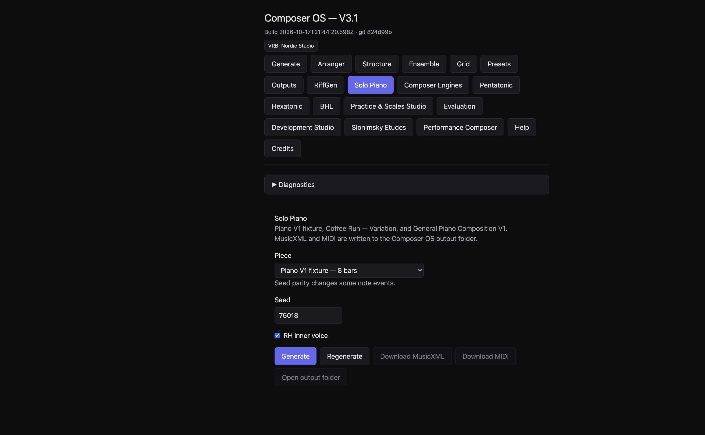
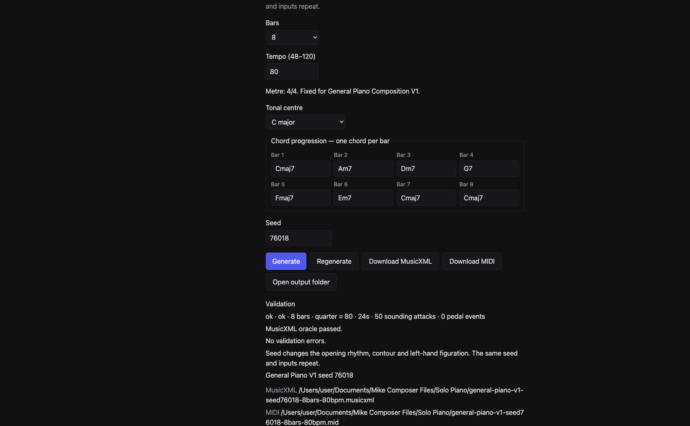
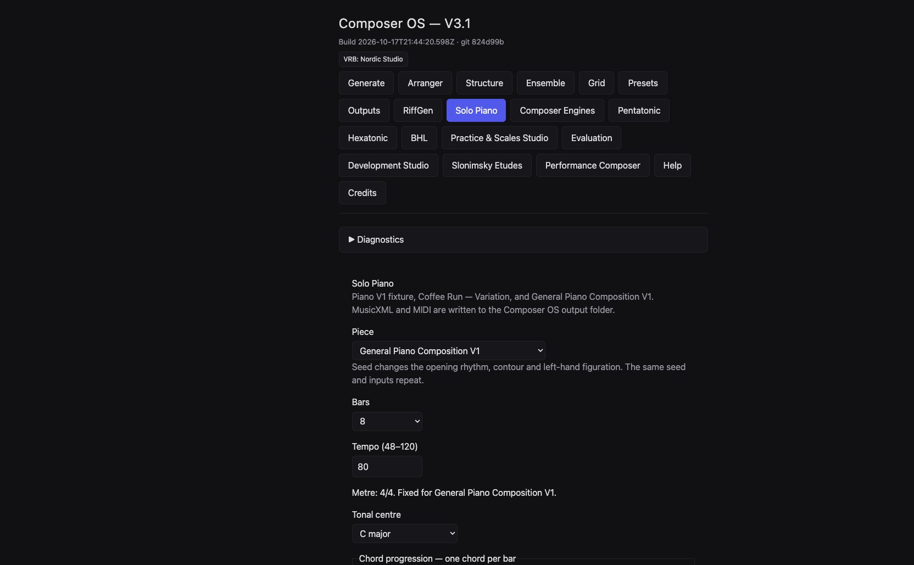

# COMPOSER OS

# SOLO PIANO COMPOSER

# MUSICIAN'S GUIDE V1.0

**TECHNICALLY VERIFIED DRAFT**

This draft describes what Solo Piano did on commit `51e170692272643ecff7bcfb6ccd461767a2d731` on 17 October 2026. MusicXML and MIDI files in the example pack were generated from that source. One of those files was also produced from the Solo Piano page and matched the pack byte for byte.

Sibelius has not been used to inspect these scores. Cubase has not been used to import these MIDI files. Nothing in this guide has been heard or played as a musical acceptance. A valid file is not a judgement that the piece is good.

The older research note, written against commit `824d99b2`, said General Piano was unavailable. That statement is out of date. General Piano Composition V1 is on this page.

## Contents

1. Introduction
2. Quick start
3. The three composition paths
4. Writing a new piano composition
5. Working with chord progressions
6. Seeds and musical variation
7. Musical form, motifs and development
8. Right-hand and left-hand relationships
9. Film cue timing and composition length
10. Six unusual creative applications
11. Sibelius MusicXML workflow
12. Cubase MIDI workflow
13. Working alongside other Composer OS modules
14. Current limitations
15. Troubleshooting
16. Musical evaluation checklist
17. Eight exercises

## 1. Introduction

Solo Piano writes a piano score for two hands and saves it as MusicXML and MIDI.

There are three choices.

The eight-bar study is a fixed piece. You can change the seed and turn one extra right-hand note on or off. You cannot type your own chords, key, length or tempo.

Coffee Run — Variation is a fixed 24-bar cue. It lasts 90 seconds at quarter note = 64. A new seed does not change its notes. The extra right-hand layer changes two bars only.

General Piano Composition V1 is the path for a new piece. You choose 8, 16 or 24 bars, a tempo from 48 to 120, C major or A minor, one chord in every bar, and an integer seed. The right hand and the left hand are written as separate parts. The same settings repeat. Different seeds, and different chords, change the notes.

Solo Piano does not turn a piano piece into a string quartet, a big band, or an orchestra. Those jobs, where they exist at all, are other pages or outside work in Sibelius or Cubase.

## 2. Quick start

Open Composer OS and choose **Solo Piano**.

For a first new piece:

1. Set **Piece** to **General Piano Composition V1**.
2. Leave **Bars** at **8**.
3. Set **Tempo (48–120)** to **80**. The box opens at 64. Eighty is an allowed tempo, and it is the tempo used for the eight-bar examples in this guide.
4. Leave **Tonal centre** on **C major**.
5. Check the eight chord boxes. They should read, in order: `Cmaj7`, `Am7`, `Dm7`, `G7`, `Fmaj7`, `Em7`, `Cmaj7`, `Cmaj7`.
6. Leave **Seed** at `76018`.
7. Press **Generate**.

A successful result on this build showed:

`ok · ok · 8 bars · quarter = 80 · 24s · 50 sounding attacks · 0 pedal events`

Then: **MusicXML oracle passed.** **No validation errors.** The title line was **General Piano V1 seed 76018**.

Read the MusicXML path and the MIDI path under that message. Press **Download MusicXML** or **Download MIDI** if you want a copy in your downloads. Press **Open output folder** to open the folder the page just named. This draft did not click that folder button, so it does not claim a Finder window opened.

Copy any file you mean to keep or edit. Generating again with the same seed, bar count and tempo writes the same General Piano filename, even if you have changed the chords or the tonal centre.

**Regenerate** sends the same settings again. It does not choose a new seed. To hear another version, type another whole-number seed and press **Generate**.

The window title on that running copy still said **Composer OS — V3.1** and **git 824d99b**. That stamp belonged to the process that had been started earlier. The page itself offered General Piano, and the file it wrote matched the example generated from commit `51e17069`. Trust the controls and the files, and check the commit if the stamp and the music disagree.

## 3. The three composition paths

### Eight-bar study

On the page this choice is **Piano V1 fixture — 8 bars**.

It is eight bars of 4/4 at quarter note = 64. The notated span is 30 seconds. In the generated MIDI for seed 76018, the last note release was at 28.125 seconds. The bar grid and the last note release are not the same moment.

The chords are fixed:

`Dm9 | Dm9 | Cmaj7 | Dm9 | Fmaj7 | Cmaj7 | Dm9 | Dm9`

There is no chord box for this path. The opening right hand, seed 76018, inner voice on or off, was `D4 E4 B4 A4 G4`, in quarter, quarter, quarter, eighth, eighth. Bar 7 repeated that same right-hand line. The left hand in bar 1 held `D3` for the whole bar.

**RH inner voice** adds or removes one held right-hand note. With it on, seed 76018 had 45 sounding attacks and a held `F4` in bar 7. With it off, the same seed had 44 attacks and no second right-hand voice. Coffee Run is the other path that uses this checkbox.

The line under the piece menu says: **Seed parity changes some note events.**

### Coffee Run — Variation

On the page this choice is **Coffee Run — Variation — 24 bars**.

It is 24 bars of 4/4 at quarter note = 64. The page and the file both report 90 seconds. The last MIDI note release in the checked file was also at 90 seconds. A piano sound can ring after that release. This guide did not listen for that ring.

Seeds `76018` and `76019` produced the same notes. The line under the menu says: **Seed changes do not change its notes. It is a fixed composition.**

Inner voice on: 110 sounding attacks and 44 pedal events. Inner voice off: 108 sounding attacks, still 44 pedal events. The two extra notes sit in bars 17 and 18.

The first right-hand notes were `E5 D5 C5`, starting after an eighth rest. The first left-hand note was a held `A2`. The key signature in the file is A minor with no sharps or flats. That is a file fact. It is not a claim about how the cue feels.

The chords in the written score are not a separate reference list. The written bar chords are:

`Am(add9) | Fmaj7 | C/E | G6sus2 | Fmaj9 | Am9/E | Dm9 | Cmaj7 | Fmaj7 | Am(add9)/E | Dm7 | Am7 | Bbmaj7(#11) | Fmaj7/A | Dm9 | Am7/E | Fmaj9 | Am(add9) | Dm9 | Cmaj7 | Am(add9) | Dm9 | C(add9)/E | Fmaj7(add9)`

You cannot type a different progression on this path.

### General Piano Composition V1

This is the only path with **Bars**, **Tempo (48–120)**, **Tonal centre**, and **Chord progression — one chord per bar**.

The metre line reads: **Metre: 4/4. Fixed for General Piano Composition V1.**

The seed line reads: **Seed changes the opening rhythm, contour and left-hand figuration. The same seed and inputs repeat.**

There is no **RH inner voice** checkbox on this path. The checked General Piano files contain a right-hand voice and a left-hand voice, and no second right-hand voice. They also contain no pedal events.

## 4. Writing a new piano composition

Use General Piano when the notes should follow your chords and your seed.

Work in this order.

1. Choose **General Piano Composition V1**.
2. Choose **8**, **16** or **24** bars. Other lengths are refused. Twelve bars and four bars were refused in the check.
3. Type a whole-number tempo from 48 to 120. The box opens at 64. Tempo 47, 121 and 64.5 were refused.
4. Choose **C major** or **A minor**. A request for D was refused. Both choices use a key signature with no sharps or flats. C major is stored as major. A minor is stored as minor. The signature does not add accidentals by itself. Accidentals come from the chords, when a chord needs them.
5. Type one chord in every box. Empty boxes and unknown spellings are refused.
6. Type a whole-number seed. `1.5` was refused.
7. Press **Generate**.
8. Read the validation line before you open the file.
9. Copy the MusicXML and MIDI if you will edit them.

Changing **Tonal centre** does not rewrite the chord boxes. Changing **Bars** keeps the chords already typed and fills any new bars. After either change, read every box and replace anything that is not the progression you want.

**Regenerate** repeats the current boxes. It is useful after you confirm the settings. It is not a new idea.

The title is chosen for you: **General Piano V1 seed** plus the seed number. There is no title box.

## 5. Working with chord progressions

One box is one bar. The symbol must be one word, with no space. `Cmaj7` is accepted. `C maj7` is not. `CMaj7` is not, because the quality has to be spelled in the accepted lowercase form. `Cxyz` is not. A blank box is not.

These spellings were accepted by the same reader the writer uses:

`Cmaj7`, `Am7`, `Dm7`, `G7`, `Fmaj7`, `Em7`, `E7`, `Am`, `F`, `Dm`, `C`, `G`, `Bbmaj7`, `C/E`, `Am(add9)`, `Fmaj9`, `G6sus2`, `Dm9`, `Am9`, `Am9/E`, `Cmaj7/E`, `Fmaj7/A`, `Bbmaj7(#11)`, `C(add9)/E`, `Fmaj7(add9)`.

A slash chord is allowed when the bass note is a single note name, such as `E`, `A`, `Bb` or `F#`.

Major triads can be written `C` or `Cmaj`. Minor triads can be written `Am` or `Amin`. Sevenths include `Cmaj7`, `Am7`, `Amin7`, `G7` and `C9`. Also accepted, when spelled exactly, are `maj9`, `m9`, `6`, `sus2`, `sus4`, `6sus2`, `add9`, `(add9)`, `m(add9)`, `maj7(#11)`, `maj7(add9)`, `m7b5`, `dim`, `aug` and `7sus4`, each after a root such as `C` or `Bb`.

If a symbol is refused, the page shows the refusal and does not pretend a score was written. The checked message for `Cxyz` was: **Invalid piano chord symbol Cxyz.**

On strong beats, the right-hand notes of a successful General Piano file are chord tones. Between those beats, the right hand may also use the white-key collection C D E F G A B. Every left-hand note in a successful file is a chord tone, including the bass of a slash chord. That is a rule of the writer. It is not a promise that the voicing is the one you would choose.

Changing the chords changes the sounding pitches. Seed `76018`, eight bars, tempo 80, C major:

- Chords `Cmaj7 | Am7 | Dm7 | G7 | Fmaj7 | Em7 | Cmaj7 | Cmaj7` gave 50 attacks. Bar 1 left hand held `C3`.
- Chords `Fmaj7 | G7 | Em7 | Am7 | Dm7 | G7 | Cmaj7 | Bbmaj7` gave 49 attacks. Bar 1 left hand held `F3`. The right-hand line also changed later in the piece. Bar 7 was `G5 B4 G4 F4`, not the opening `C5 E5 C5 B4`.

Same seed. Different harmony. Different notes. The official filename would be the same for both, because the name stores seed, bar count and tempo only.

## 6. Seeds and musical variation

A seed is a whole number that makes a result repeatable.

### Eight-bar study

Seeds `76018` and `76020`, inner voice on, were the same piece: 45 attacks, and the same notes. Seed `76019` was different, still 45 attacks, still the same opening right hand.

In bar 4 the left hand of `76018` was `D3 F3 A3 C4 A3 F3 D3 A3`, all eighths. Seed `76019` was `A3 F3 D3 F3 A3 C4 A3 D3`. In bar 7 the extra right-hand note was `F4` for `76018` and `C5` for `76019`.

Two different seed numbers can name one piece. Three seed numbers do not mean three pieces on this path.

### Coffee Run

`76018` and `76019` matched, inner voice on: 110 attacks, 44 pedal events. Use a new seed here only as a label. Do not expect a new cue.

### General Piano

Seeds `76018`, `76019` and `76020` were three different pieces when the chords, bars, tempo and tonal centre stayed the same. Eight bars, tempo 80, C major, the opening chord boxes from section 2:

| Seed | Bar 1 right hand | Attacks |
| --- | --- | --- |
| 76018 | C5 E5 C5 B4, all quarters | 50 |
| 76019 | C5, then B4 and G4 as eighths, then G4 as a half | 52 |
| 76020 | E5 C5 C5 F5, all quarters | 50 |

Bar 1 of the left hand was a held `C3` in all three. Later left-hand notes are part of what the seed changes. The same seed with the same chords repeats.

Tempo does not choose new pitches. The 24-bar miniature in section 9 used the same notes at quarter note = 64 and at quarter note = 80. Only the speed changed: 90 seconds against 72 seconds.

## 7. Musical form, motifs and development

General Piano plans each length in stages. You do not pick the stages from a menu.

Eight bars, in order: statement, a moved statement, two development bars, two contrast bars, a return, a held ending.

Sixteen bars: a statement and three moved bars, four contrast bars, four development bars, a return, one moved bar, an approach, a held ending. The return is bar 13.

Twenty-four bars: a statement and seven moved bars, eight contrast bars, four development bars, a return, one moved bar, an approach, a held ending. The return is bar 21.

The return keeps the rhythm of the opening right hand when the writer can fit it. It does not always keep the same pitches. In the eight-bar C major example, bars 1 and 7 were both `Cmaj7`, and seed `76018` repeated `C5 E5 C5 B4` in both bars. Seed `76020` opened `E5 C5 C5 F5` and returned `E4 C5 C5 F5`: same rhythm, first note an octave lower. In the eight-bar length exercise, bar 7 is an F chord, and the return was `F5 A5 F5 E5`, not a copy of bar 1.

The last bar of the eight-bar C major example was a held `C5` in the right hand. The left hand tied `C3` and `E3` from bar 7 into the first half of bar 8, then played `G2`.

The eight-bar study is a different plan. Its opening cell is `D4 E4 B4 A4 G4`. Bar 5 holds `D4` then `E4`, each for a half note: the first two notes of the cell, each twice as long as the original quarters. Bar 6 puts `D3 E3` in the left hand, the opening `D E` one octave lower, then continues the right hand on `G4 A4`. Bars 7 and 8 bring the opening right hand back. That return was checked in the MusicXML. Whether it sounds prepared is a listening question, not a result this draft can certify.

## 8. Right-hand and left-hand relationships

The two hands are written separately.

In General Piano the right hand is the upper staff. The left hand is the lower staff. They do not have to play the same rhythm. In the eight-bar C major example, bar 1 is four right-hand quarters over one left-hand whole note. Bar 5, the first contrast bar, starts with `C5` in the right hand, then an eighth rest, then `B4 C5` and an eighth `E5`. The left hand rests for a quarter, then plays `C3 F3 E3`. That left-hand line is not a copy of the right hand. It is a separate answer on the Fmaj7 of that bar.

Across the checked General Piano files, the left hand uses holds, broken chords, short two-note figures, answers in the contrast bars, and ties into the ending when two chords share a tone. You cannot choose which of those jobs a bar receives.

The eight-bar study shows one clear hand-to-hand echo. Right hand bar 1 begins `D4 E4`. Left hand bar 6 begins `D3 E3`. Same two letter names, one octave lower, later in the piece.

**RH inner voice** belongs only to the study and to Coffee Run. On the study it is one held note in bar 7. On Coffee Run it changes bars 17 and 18. It is not a density knob, and it is not available while General Piano is selected.

Range in the General Piano writer is limited. Right-hand pitches are kept between MIDI 64 and 81, which is E4 to A5. Left-hand pitches are kept between MIDI 43 and 54, which is G2 to F#3. A line that would leave that window is pulled back. This is why a return can appear an octave away from the opening.

No pianist has tested whether these spans are comfortable at the chosen tempo.

## 9. Film cue timing and composition length

At a steady quarter-note tempo in 4/4, the bar grid lasts `240 × bars ÷ tempo` seconds.

| Bars | Tempo | Grid |
| --- | --- | --- |
| 8 | 64 | 30 seconds |
| 8 | 80 | 24 seconds |
| 16 | 80 | 48 seconds |
| 24 | 64 | 90 seconds |
| 24 | 80 | 72 seconds |
| 24 | 120 | 48 seconds |

Those grid lengths were the durations reported for the matching generated files, except that a 24-bar piece at 120 was not generated for this pack. The arithmetic is the same rule the writer uses. Tempo 120 is inside the allowed range.

Coffee Run is the fixed 90-second cue. Its film words are not a four-bar form. They sit on these bars. Times are from the start, at quarter note = 64.

| Bar | Time | Words in the score |
| --- | --- | --- |
| 1 | 0:00.00 | Very gently; with space between phrases |
| 3 | 0:07.50 | Proposal / warmth, without sentimentality |
| 11 | 0:37.50 | Cemetery — more restrained |
| 12 | 0:41.25 | Pram — tenderness |
| 17 | 1:00.00 | Apartment — allow the melody to arrive |
| 19 | 1:07.50 | Toward black — diminuendo |
| 21 | 1:15.00 | Credits — distant echo, freely |
| 24 | 1:26.25 | Let the last chord disappear |

Bars 5, 9, 13, 17 and 21 also fall on a 15-second ruler: 0:15, 0:30, 0:45, 1:00 and 1:15. That ruler is clock arithmetic. It is not the cue’s section list. Bar 17 happens to sit on both the ruler and a film line. The other film lines do not.

The MIDI file does not carry those words as DAW markers. Put picture markers in Cubase yourself.

A new 90-second piece is General Piano, 24 bars, tempo 64, not a shorter Coffee Run. Exercise 5 writes one. It will not land on the Coffee Run film lines unless you place them yourself.

The study’s last note release at 28.125 seconds, inside a 30-second grid, is a reminder to look at both the bar grid and the last release. The General Piano files checked for this guide released their last notes at the end of the grid. A ringing piano sample can still continue. That was not recorded.

## 10. Six unusual creative applications

These are uses of the current controls. They are not six extra styles.

1. **Compare a seed that changes almost nothing.** Eight-bar study, inner voice on, seeds `76018` and `76020`. The notes match. Then compare `76019`. The opening right hand stays. Bar 4 in the left hand and the held note in bar 7 change.

2. **Remove one held note.** Same study, seed `76018`, inner voice on, then off. You lose one attack, the held note in bar 7. The main line stays.

3. **Follow two notes into the other hand.** Study, seed `76018`, inner voice off. Mark `D4 E4` in bar 1 and `D3 E3` in bar 6.

4. **Set a return beside its statement.** Study, bars 1 and 7, same right hand. Separately, General Piano seed `76018` at tempo 80 with the opening C major boxes: bars 1 and 7 match. Seed `76020` shows a return that keeps the rhythm and moves the first note down an octave.

5. **Read a fixed cue against a clock.** Coffee Run, seed `76018`, inner voice on. Use the table in section 9. Decide for yourself whether a film line sits where you want it. The page will not move the line.

6. **Write a different piece for the same 90 seconds.** General Piano, 24 bars, tempo 64, seed `76018`, chords `Am | F | Dm | E7` repeated. The grid is 90 seconds and the notes are not Coffee Run. The opening right hand in the generated file was `A4 C5 C5 G4`. Coffee Run’s opening right hand was `E5 D5 C5` after an eighth rest.

## 11. Sibelius MusicXML workflow

This is outside Composer OS. Sibelius was not opened for this draft. No score page in this guide is a Sibelius plate.

1. Generate the piece.
2. Copy the MusicXML out of the output folder before you edit. A later **Generate** can replace the original name.
3. In Sibelius, open the copy as a new score, or use File, Import, Browse into a score you already chose. Do not close unrelated scores.
4. Check the preview. Solo Piano writes one piano part on two staves. The upper staff is the right hand. The lower staff is the left hand.
5. Before you trust the engraving, look at ties, rests, chord symbols, clefs, and any pedal marks. Coffee Run has pedal events. The General Piano examples in this pack do not.
6. Save a separate Sibelius file. Edits in Sibelius do not return to Solo Piano.

Until those pages are inspected, do not treat the example MusicXML as engraved or ready to print.

## 12. Cubase MIDI workflow

This is outside Composer OS. Cubase was not opened for this draft. No piano-roll picture is included.

1. Copy the MIDI file before you import it.
2. Import it into a new project, or review the import options in a project you already have. Tempo and controller choices matter. Coffee Run is quarter note = 64 and contains 44 pedal events in the checked files. A General Piano file carries the tempo you typed and, in this pack, no pedal events.
3. The file is one piano part, not separate right-hand and left-hand tracks.
4. Confirm the tempo and the note times before you quantise or move anything.
5. Save a Cubase project. It does not write back to Solo Piano.

Hearing the result, choosing a piano sound, and judging the pedal are still to be done.

## 13. Working alongside other Composer OS modules

No automatic piano-to-orchestra path was found, and none was run. The piano writer does not call Song Mode, BHL, Pentatonic, Hexatonic, the Riff Generator, String Quartet, Big Band, ECM Chamber, composer profiles, Stage C orchestration or Stage D blending.

An older read of the importers, on commit `824d99b2`, already warned that a piano file is a poor match for tools that expect guitar and bass. Those importer tests were not repeated on the new General Piano files. They are not promoted to working connections.

| Module | What you can do now | Status |
| --- | --- | --- |
| Song Mode | Keep the piano file as a reference. Do not expect both hands to survive a generic melody import unchanged. | PARTIAL / UNVERIFIED |
| BHL Worlds A–F | BHL looks for a bass part. A piano left hand was not established as that bass part. | PARTIAL / UNVERIFIED |
| Pentatonic | The Pentatonic page can open MusicXML, but a piano grand staff is not a guitar-and-bass analysis. | PARTIAL / UNVERIFIED |
| Hexatonic | Hexatonic builds its own material. No piano handoff was found. | FUTURE ONLY |
| Riff Generator | Riffs are a separate page. No piano-score-to-riff path was found. | FUTURE ONLY |
| String Quartet | Arranger can start from a lead sheet. That is not a transfer of both piano hands. | PARTIAL / UNVERIFIED |
| Big Band | Same limit as the quartet path. Pedal, ties and inner notes are not shown to survive. | PARTIAL / UNVERIFIED |
| ECM Chamber | ECM is its own generation path. No piano-score handoff was found. | FUTURE ONLY |
| Composer Profiles | Profiles do not appear on the Solo Piano page and are not sent with a piano request. | FUTURE ONLY |
| Stage C orchestration | Orchestration can read MusicXML and reduce a melody. That is not a piano-to-orchestra conversion of both hands. | PARTIAL / UNVERIFIED |
| Stage D blending | Blending belongs to Song Mode harmony. It is not a Solo Piano control. | FUTURE ONLY |

A useful manual workflow is ordinary editing. Finish the piano piece, copy the MusicXML into Sibelius, and write the other instruments there. Or import the MIDI into Cubase and assign parts by hand. Say that you did that work. Do not say Composer OS orchestrated the piano piece.

## 14. Current limitations

- Three paths only. The study and Coffee Run do not become General Piano if you type extra numbers.
- General Piano is 4/4 only, and only 8, 16 or 24 bars.
- Tempo is a whole number from 48 to 120. The study and Coffee Run stay at 64.
- Tonal centre is C major or A minor. Both use an empty key signature.
- One chord per bar, in the accepted spelling, with no spaces.
- The right-hand window is E4 to A5. The left-hand window is G2 to F#3.
- You cannot choose the motif operation, the left-hand texture, or the bar where the return falls.
- General Piano has no inner-voice control and, in this pack, no pedal.
- Coffee Run ignores the seed for notes.
- On the study, seed `76020` repeats seed `76018`.
- **Regenerate** does not invent a new seed.
- Saved General Piano names omit the chords and the tonal centre, so a new progression can replace an older file.
- There is no title box and no picture-hit control.
- Locked events exist in the writer for material that already matches. The page has no control for importing your own sketch and composing around it.
- Download buttons save copies. They do not open Sibelius or Cubase.
- The dev window used for the screenshots still displayed an older git stamp.

## 15. Troubleshooting

| What you see | What it means |
| --- | --- |
| Piano composition V1 needs an integer seed. | The seed is blank or not a whole number. |
| General piano V1 accepts 8, 16 or 24 bars. | Another length was sent. The menu only offers the three allowed lengths. |
| General piano V1 tempo must be an integer from 48 to 120. | Tempo is outside that range, or it has a decimal. |
| General piano V1 tonal centre must be C or Am. | Only the two menu choices work. |
| General piano V1 supports 4/4 only. | Another metre was sent. The page does not offer one. |
| Invalid piano chord symbol … | Fix that box. Remove spaces. Use the spellings in section 5. |
| General piano V1 needs one chord symbol for every bar. | The number of chords does not match the bar count. |
| Piano composition V1 checkpoint accepts 8 bars only. | Bars were sent to the eight-bar study. That path is fixed. |
| Coffee Run variation tempo is quarter note = 64. | Tempo was sent to Coffee Run. That path is fixed. |
| Unknown piano film cue. | Coffee Run is the only film cue on this page. |
| MusicXML oracle passed. | The written MusicXML matched the score’s notes, including ties. It does not grade engraving or musical quality. |
| No validation errors. | The writer’s own checks passed. It is not a listening report. |
| The new file replaced an older one. | Copy files first. General Piano names use seed, bars and tempo only. |
| Seed 76020 sounds like 76018 on the study. | That match is real. Use General Piano when you need three different seeds to mean three pieces. |
| The header git stamp looks old. | The running window can keep a stamp from when it was started. Compare a generated file with the example pack, or with the commit named on the cover. |

## 16. Musical evaluation checklist

Use this after you can see the score and, when you are ready, hear it. None of these questions has been answered for the example pack.

- Can you recognise the opening idea when it returns?
- Does the left hand support, answer, or only fill?
- Do the chord tones you asked for actually sound, especially on the strong beats?
- Are both hands in a register you can balance?
- Do the rests and held notes give the line room?
- Does the last bar stop in a way that fits the length you chose?
- For a picture cue, do the musical changes sit where the picture needs them, apart from the printed clock?
- Are ties, rests and chord symbols clear on the page in Sibelius?
- In Cubase, do tempo, note lengths and pedal match the file before you edit?
- Which notes will you keep, and which will you rewrite yourself?

Automated tests, a MusicXML check, engraving, MIDI playback and artistic quality are five different things. This draft covers the first two only for the files it generated, and a live page check for one General Piano setting.

## 17. Eight exercises

Copy each result before the next **Generate** if it shares a seed, a bar count and a tempo. Open the named file from the example pack if you want the same notes without generating again.

### Exercise 1. Same chords, three seeds

**Purpose.** Hear three General Piano versions of one progression.

**Settings.** Piece: General Piano Composition V1. Bars: 8. Tempo: 80. Tonal centre: C major. Chords: `Cmaj7 | Am7 | Dm7 | G7 | Fmaj7 | Em7 | Cmaj7 | Cmaj7`. Seeds: `76018`, then `76019`, then `76020`.

**Steps.** Type the first seed. Generate. Copy both files. Change only the seed. Generate. Copy again. Repeat for the third seed.

**Expected technical behaviour.** Three different note lists. Attacks 50, 52 and 50. Bar 1 right hands are in the table in section 6. Bar 1 left hand holds `C3` each time. Each file reports 24 seconds and no pedal. Example files: `general-c-8-seed76018-q80`, `general-c-8-seed76019-q80`, `general-c-8-seed76020-q80`.

**Listen for.** Whether the rhythm of bar 1 changes your sense of the phrase. This draft does not say which version is clearer.

**Limit.** The left hand of bar 1 did not change among these three seeds. Look past bar 1 before you decide the left hand is fixed.

### Exercise 2. Same seed, different harmony

**Purpose.** See that chord changes move the notes, not only the chord symbols.

**Settings.** Both versions: General Piano, 8 bars, tempo 80, C major, seed `76018`.

Version A chords: `Cmaj7 | Am7 | Dm7 | G7 | Fmaj7 | Em7 | Cmaj7 | Cmaj7`.

Version B chords: `Fmaj7 | G7 | Em7 | Am7 | Dm7 | G7 | Cmaj7 | Bbmaj7`.

**Steps.** Generate A and copy it. Replace all eight chords with B. Generate and copy it. Do not rely on the output filename to keep both.

**Expected technical behaviour.** A has 50 attacks and bar 1 left hand `C3`. B has 49 attacks and bar 1 left hand `F3`. Bar 7 of A repeats the opening right hand. Bar 7 of B is `G5 B4 G4 F4`. Files: `general-c-8-seed76018-q80` and `general-c-8-seed76018-other-q80`.

**Listen for.** How soon the new bass note changes the bar. No mood is claimed here.

**Limit.** `Bbmaj7` brings a B-flat into the left-hand chord tones. The key signature still has no flats. Read the accidentals in the score rather than assuming the signature shows them.

### Exercise 3. C major beside A minor

**Purpose.** Compare two prepared tonal settings. The centre menu alone does not rewrite the chords.

**Settings.** Both: General Piano, 8 bars, tempo 80, seed `76018`.

C major chords: `Cmaj7 | Am7 | Dm7 | G7 | Fmaj7 | Em7 | Cmaj7 | Cmaj7`.

A minor: set **Tonal centre** to **A minor**, then replace the boxes with `Am7 | Dm7 | E7 | Am7 | Fmaj7 | Cmaj7 | Am7 | Am7`.

**Steps.** Generate the C major version and copy it. Switch the centre. Replace every chord. Generate and copy again.

**Expected technical behaviour.** The C major file is major, 50 attacks, bar 1 right hand `C5 E5 C5 B4`, left hand `C3`. The A minor file is minor, 50 attacks, bar 1 right hand `A4 C5 C5 G4`, left hand `A2`. Both signatures have zero sharps or flats. Both last 24 seconds. File: `general-am-8-seed76018-q80`.

**Listen for.** Whether the opening note and the bass make the two settings easy to tell apart. That question is yours.

**Limit.** This changes the centre and the chords together. It is not a test of the centre menu by itself.

### Exercise 4. Eight, sixteen and twenty-four bars

**Purpose.** Compare length at one tempo and one repeating progression.

**Settings.** General Piano. Tempo 80. Tonal centre C major. Seed `76018`. Chords repeat `C | Am | F | G` for the whole length: two times for 8 bars, four times for 16, six times for 24.

**Steps.** Set **Bars**, then type the list so every box matches. Do not assume the old boxes survived the length change correctly. Generate and copy at each length.

**Expected technical behaviour.** Grids of 24, 48 and 72 seconds. Attacks 49, 102 and 152. Bar 1 is the same in all three: right hand `C5 E5 C5 B4`, left hand `C3`. The eight-bar return, bar 7, is the F chord and reads `F5 A5 F5 E5`. The 16-bar return is bar 13 and matches bar 1. The 24-bar return is bar 21 and matches bar 1. Files: `general-c-8-length-q80`, `general-c-16-length-q80`, `general-c-24-length-q80`.

**Listen for.** Whether the longer versions do more than repeat the opening. This draft only reports where the return matches and where it does not.

**Limit.** Same opening bar does not mean the later piece is a copy. Compare a middle bar, not only bar 1.

### Exercise 5. A new 90-second miniature

**Purpose.** Fill the same clock as Coffee Run with a different piece.

**Settings.** General Piano. Bars 24. Tempo 64. Tonal centre A minor. Seed `76018`. Chords: `Am | F | Dm | E7` repeated six times, all 24 bars.

**Steps.** Set every control, including all 24 boxes. Generate. Read the validation line for 24 bars, quarter = 64, and 90 seconds.

**Expected technical behaviour.** 153 sounding attacks, no pedal, minor signature with no sharps or flats, last MIDI release at 90 seconds. Bar 1 right hand `A4 C5 C5 G4`. Bar 1 left hand `A2`. Bar 21 return `A5 C5 C5 G4`: same rhythm, first note an octave higher. File: `general-miniature-24-q64`.

**Listen for.** Where you would want a picture change. The file has no film words.

**Limit.** Ninety seconds is the bar grid of 24 bars at 64. It is not a claim that the last chord feels final.

### Exercise 6. Fixed Coffee Run beside General Piano

**Purpose.** Keep the fixed cue and the new 90-second piece distinct.

**Settings.** First: Piece **Coffee Run — Variation — 24 bars**, seed `76018`, **RH inner voice** on. Second: the miniature in exercise 5.

**Steps.** Generate Coffee Run and copy it. Switch to General Piano and generate the miniature. Do not describe the miniature as a Coffee Run variation.

**Expected technical behaviour.** Coffee Run: 110 attacks, 44 pedal events, 90 seconds, opening right hand `E5 D5 C5` after an eighth rest, opening left hand `A2`. The miniature: 153 attacks, no pedal, 90 seconds, opening right hand `A4 C5 C5 G4`. Changing the Coffee Run seed to `76019` does not change its notes. Changing a General Piano seed does.

**Listen for.** The difference in opening rhythm and in pedal. No style comparison is certified.

**Limit.** Both last 90 seconds because both are 24 bars at 64. Shared duration is not shared music.

### Exercise 7. Independent left-hand answers

**Purpose.** Find a left-hand moment that is not only a held bass.

**Settings.** Two short scores.

Study: **Piano V1 fixture — 8 bars**, seed `76018`, inner voice off.

General: exercise 1’s first version, seed `76018`.

**Steps.** In the study, compare right-hand bar 1 (`D4 E4` at the start) with left-hand bar 6 (`D3 E3`). In the General Piano file, read bar 5: right hand `C5`, eighth rest, `B4`, `C5`, eighth `E5`; left hand quarter rest, then `C3 F3 E3`.

**Expected technical behaviour.** Those pitches are in `study-seed76018-no-inner` and `general-c-8-seed76018-q80`. The hands are different voices on different staves.

**Listen for.** Whether the later left-hand notes sound related to the opening. The files do not answer that.

**Limit.** You cannot move the answer to another bar from the page.

### Exercise 8. Continue in Sibelius or Cubase

**Purpose.** Leave a copy you can edit without losing the generated file.

**Settings.** Any file in the example pack. A practical pair is `study-seed76018-no-inner.musicxml` for notation and `coffee-run-seed76018-inner.mid` for pedal and tempo.

**Steps.** Copy the file out of the example folder. Follow section 11 or section 12. Keep the untouched copy.

**Expected technical behaviour.** The MusicXML is one piano part on two staves. The Coffee Run MIDI has 110 notes and 44 pedal events at quarter note = 64. The study MIDI has 44 notes if the inner voice is off, and its last release is at 28.125 seconds.

**Listen for.** After you import and play, decide what you want to change. That listening has not been done for this draft.

**Limit.** Sibelius and Cubase screenshots are pending. Do not treat this exercise as finished until you have opened the file yourself.

## Illustration status

| Figure | Status |
| --- | --- |
| Solo Piano page, eight-bar study | Captured from the running page. |
| General Piano controls and validation | Captured after Generate. The file matched the example pack. |
| Right-hand and left-hand notes | Listed from the MusicXML. Not an engraved staff. |
| Seed comparison | Listed from the MusicXML in section 6. |
| Statement and return | Listed from the MusicXML in sections 7 and 17. |
| Harmonic change | Listed from the MusicXML in exercise 2. |
| 90-second timeline | Calculated table in section 9. Not an application screenshot. |
| Sibelius | Pending. Not opened. |
| Cubase | Pending. Not opened. |

## Build note

Commit inspected: `51e170692272643ecff7bcfb6ccd461767a2d731`.

Research preserved beside this guide was written against `824d99b241df3db9a72d47f91f659e1aa312aa1c`. Where it says General Piano is absent, use this guide instead.

Example settings, attack counts and pitch lists come from `examples/evidence.json` and from the MusicXML files next to it. One live **Generate** wrote the same bytes as `examples/general-c-8-seed76018-q80.musicxml` and its MIDI pair.
